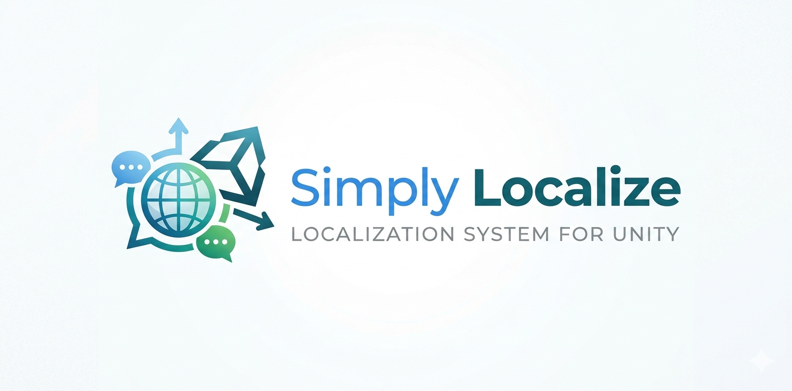
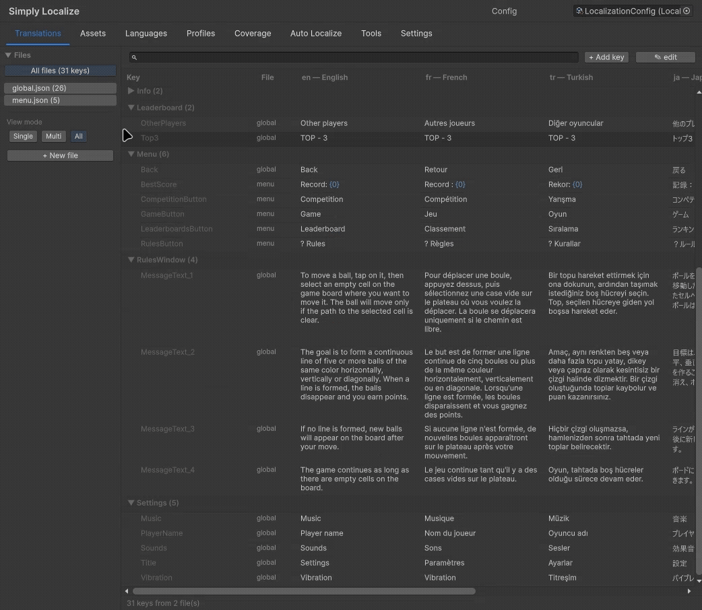
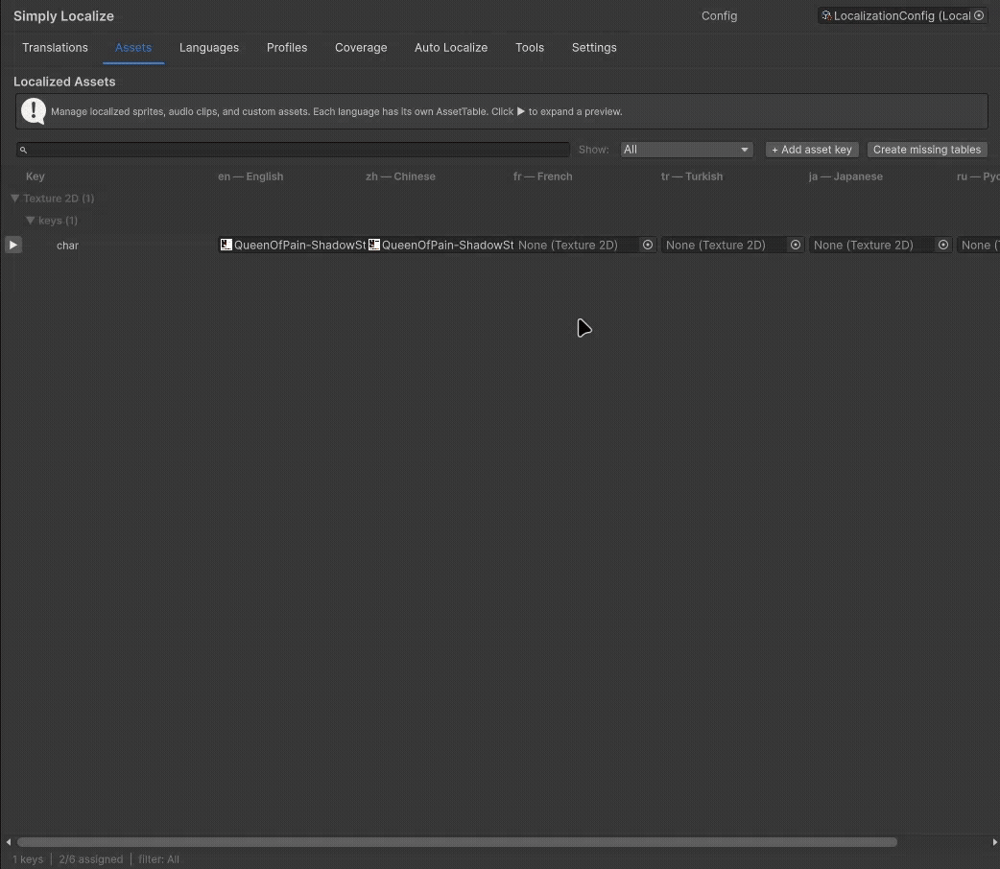
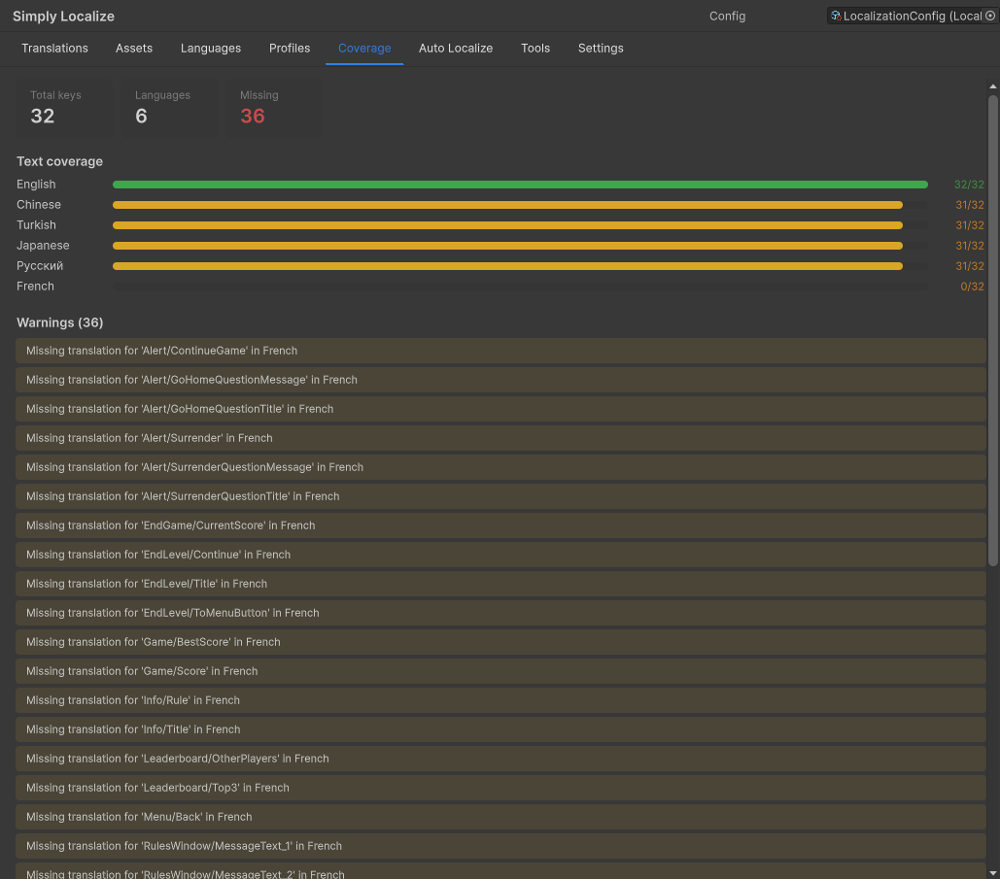

# Simply Localize



A modern, flexible localization system for Unity. Manages translations, localized assets (sprites, audio, any `UnityEngine.Object`), fonts per language, pluralization across languages, runtime language switching, and a rich editor workflow — all without external dependencies.

*Read in other languages: [Russian](README_RU.md).*

Development project: [playgrounds/SimplyLocalize-Lab](playgrounds/SimplyLocalize-Lab/README-LAB.md) (Unity 6000.0.62f1). It imports `src/SimplyLocalize` as a local UPM package. Keep new files and their Unity-generated `.meta` files together in version control. See the [numbered migration report](docs/project-structure/0001-local-package-migration/REPORT.md) for layout and verification evidence.

---

## Table of Contents

- [Features](#features)
- [Installation](#installation)
  - [Via OpenUPM](#via-openupm)
  - [Via Package Manager (Git URL)](#via-package-manager-git-url)
  - [Via manifest.json](#via-manifestjson)
- [Quick Start](#quick-start)
- [Folder Structure](#folder-structure)
- [Editor Window](#editor-window)
- [Runtime API](#runtime-api)
- [Components](#components)
- [Spine Integration](#spine-integration)
- [Pluralization & Parameters](#pluralization--parameters)
- [Language Profiles & Fonts](#language-profiles--fonts)
- [Fallback Chains](#fallback-chains)
- [Localized Assets](#localized-assets)
- [Dependency Injection](#dependency-injection)
- [Extensibility](#extensibility)
- [Attribute Reference](#attribute-reference)
- [Migration from v1](#migration-from-v1)

---

## Features

- **Text localization** — JSON-based, one folder per language, multiple files per language merged automatically
- **Asset localization** — localize sprites, audio clips, materials, prefabs, or any `UnityEngine.Object` type through asset tables; `Localization.GetAsset<T>(key)` is the single runtime API for all types
- **Pluralization** — built-in rules for Germanic, Slavic, Romance, East Asian, and Arabic language families, via simple inline syntax (`{0|apple|apples}`)
- **Parameter substitution** — indexed (`{0}`), named (`{playerName}`), or mixed, with escaped braces and explicit form selectors
- **Language profiles** — per-language font (TMP + legacy), font size multiplier, weight, spacing, text direction (LTR/RTL), alignment overrides
- **Per-language fallback chains** — e.g. `Ukrainian → Russian → English`; each profile points to its own fallback, resolved lazily with cycle protection
- **Per-component profile overrides** — individual UI elements can override specific sections (font only, spacing only, etc.) of the language profile
- **Runtime language switching** — single call updates all active components via events
- **Optional Spine integration** — localize individual attachments or replace complete atlas pages without modifying shared Spine assets
- **Rich editor window** — virtualized translations table, search, drag-and-drop asset tables, inline previews, undo/redo, key renaming with automatic reference updates in scenes & prefabs, coverage analysis, CSV export
- **Extensible** — custom asset preview renderers and type filters via plain interfaces + `TypeCache` discovery; custom tabs via `[LocalizationEditorTab]` attribute
- **DI-friendly** — use the static `Localization` facade for simplicity, or inject `LocalizationManager` directly for testability
- **WebGL support** — console log bridge included
- **No external dependencies** — pure C#, no third-party packages required

---

## Installation

### Via OpenUPM

**Option A — OpenUPM CLI** (recommended):

```bash
npm install -g openupm-cli
openupm add com.renkoff.simply-localize
```

**Option B — manually via `Packages/manifest.json`**:

1. Add a scoped registry entry:

```json
{
  "scopedRegistries": [
    {
      "name": "OpenUPM",
      "url": "https://package.openupm.com",
      "scopes": [
        "com.renkoff"
      ]
    }
  ],
  "dependencies": {
    "com.renkoff.simply-localize": "2.0.1"
  }
}
```

### Via Package Manager (Git URL)

1. Open `Window → Package Manager`
2. Click `+ → Add package from git URL`
3. Paste:

```
https://github.com/RenKOFFF/Simply-Localize-Localization-System-for-Unity.git?path=src/SimplyLocalize
```

### Via manifest.json

Add to your `Packages/manifest.json`:

```json
{
  "dependencies": {
    "com.renkoff.simply-localize": "https://github.com/RenKOFFF/Simply-Localize-Localization-System-for-Unity.git?path=src/SimplyLocalize"
  }
}
```

---

## Quick Start

### 1. Open Simply Localize

Open **Window → Simply Localize → Localization Editor**. All primary setup happens in this window; opening an Inspector is optional.

### 2. Create the Config and Languages

On the setup screen, search by language name (English, Russian or native spelling) or code and click **Add selected language**. For example, `Ан` finds English, `ru` finds Russian and `ro` finds Romanian. The offline catalog combines Unicode CLDR names with cultures available in the editor. Choose default and fallback from your selected languages; fallback may be `(none)`. Click **Create config and languages**. This creates the startup config at `Assets/SimplyLocalize/Resources/SimplyLocalizeSettings.asset`, language profiles and empty translation files. Automatic startup is enabled. Existing translations are preserved.

If a language is missing, expand **Language not listed? Add a custom language**. Enter a registered code such as `pt-BR` or a private code such as `x-elvish`, plus a display name. The picker normalizes casing/separators (`PT_br` → `pt-BR`), resolves known ISO aliases (`rus` → `ru`) and rejects invalid codes. It does not rename existing project codes.

Already have a config? Select it in the **Config** field and open **Settings → Move config and enable automatic startup**. Its GUID and references are retained; language profiles and translations stay in place.

### 3. Manage Languages in the Window

**Languages** lets you add more codes and choose default/fallback languages. **Edit profile** opens the selected language in **Profiles**, where you can edit its name, fonts, typography and overrides. **Settings** controls startup and data loading. JSON translations can also be edited in an external text editor.

The window has 8 tabs: **Translations**, **Assets**, **Languages**, **Profiles**, **Coverage**, **Auto Localize**, **Tools**, **Settings**.

### 4. Add Your First Keys

In the **Translations** tab:
- Click **`+ Add key`** in the toolbar
- Enter a key (e.g. `UI/MainMenu/Play`) and choose a source file
- Fill in translations for each language inline

### 5. Initialize at Runtime

```csharp
using SimplyLocalize;
using UnityEngine;

public class GameBootstrap : MonoBehaviour
{
    [SerializeField] private LocalizationConfig _config;

    private void Awake()
    {
        // Initialize with explicit config
        Localization.Initialize(_config);

        // Or auto-detect the player's system language
        Localization.SetLanguageAuto();
    }
}
```

Alternatively, enable **Auto Initialize** on your `LocalizationConfig` asset — the system will load itself from `Resources` before any scene is loaded.

### 6. Use It

```csharp
string greeting = Localization.Get("UI/Welcome");
string score = Localization.Get("UI/Score", 100);
Sprite flag = Localization.GetAsset<Sprite>("flags/current");
```

Or drop a `LocalizedText` component onto any TextMeshPro / legacy Text element and pick a key in the Inspector — no code needed.

Startup ownership: the first successful initializer wins for scene bootstraps. Duplicate bootstraps leave the current manager and language intact; a conflicting config is reported. Only the bootstrap that created the active manager shuts it down on destruction. `DontDestroyOnLoad` keeps that owner alive across scene loads. A manually or automatically initialized manager remains caller-owned. Use `Localization.Initialize(config, ...)` explicitly to replace it; a validation/loading failure preserves the previous working manager. Normal `Shutdown()`/reinitialization preserves facade subscribers and disconnects the old manager's event forwarding.

Each new Play session resets the static manager, facade events and custom plural registrations, including with Domain Reload disabled (tested with Scene Reload enabled). Register custom rules again during startup, after subsystem registration. Disabling both Domain Reload and Scene Reload is outside the verified lifecycle matrix. Config validation reports duplicate codes, conflicting profile references, invalid language/path values and a default profile missing from `languages`. Empty slots are ignored; external fallback profiles and cycle-safe chains remain supported. `GetValidationErrors()` inspects a config without changing it. A config without a default requires an explicit language selection. Automatic startup loads only the reserved `SimplyLocalizeSettings` address and respects `autoInitialize`; duplicate reserved addresses are rejected during setup/build checks.

---

## Folder Structure

Your localization data lives inside any `Resources` folder:

```
Assets/
└── Resources/
    └── Localization/        ← base path (configurable in LocalizationConfig)
        ├── _meta.json       ← key metadata (descriptions, rename history)
        ├── en/
        │   ├── text/
        │   │   ├── global.json
        │   │   ├── ui.json
        │   │   └── items.json
        │   └── AssetTable.asset    ← localized sprites/audio/etc. for English
        ├── ru/
        │   ├── text/
        │   │   ├── global.json
        │   │   ├── ui.json
        │   │   └── items.json
        │   └── AssetTable.asset
        └── ja/
            ├── text/
            │   └── ...
            └── AssetTable.asset
```

Multiple JSON files per language are **merged** at runtime — split your keys by feature (ui.json, items.json, dialogue.json, etc.) for better organization and merge-friendliness in version control.

### JSON File Format

```json
{
  "translations": {
    "UI/MainMenu/Play": "Play",
    "UI/MainMenu/Quit": "Quit",
    "Game/Score": "Score: {0}",
    "Game/Coins": "You have {0} {0|coin|coins}",
    "Dialogue/Greeting": "Hello, {playerName}!"
  }
}
```

---

## Editor Window

### Translations Tab


<!-- TODO: screenshot of Translations tab -->

- **Virtualized list** — handles thousands of keys without lag
- **Nested groups** — keys like `UI/Popup/Title` automatically collapse into `UI → Popup → Title` tree
- **Search** — filter by key or translation value with 150ms debounce
- **Multi-select** — Ctrl+click for individual, Shift+click for ranges
- **Inline editing** — all languages shown as columns, click any cell to edit
- **TAB / Shift+TAB** — navigate between cells without mouse
- **Undo/Redo** — Ctrl+Z / Ctrl+Y
- **Missing translations highlighted** in red
- **Context menu** on any key: copy, rename (with reference update), move to file, delete, add description
- **Key descriptions** stored in `_meta.json` — visible below the key in the table

Metadata keeps the existing `{ "key": { "description": "...", "previousKeys": ["old"] } }`
format; no migration is needed. `description` accepts a string or null, and `previousKeys`
accepts an array of strings or null. Null/numeric/object entries inside that array are invalid.
Unicode and JSON escapes round-trip correctly, and unknown fields are retained when editing metadata.
Malformed JSON, duplicate properties, invalid UTF-8, excessive nesting (over 64 levels), and read
errors produce a warning naming `_meta.json`; JSON/schema errors include a location.
After a load error, repair the file and reload before saving. `SaveMeta()` throws instead of
overwriting unreadable metadata, overwriting a file changed since loading, or silently discarding
edits when no localization folder is configured. Writes replace the file atomically; failures keep
the previous file and pending edits. `SaveAll()` now saves translations and metadata as one
rollback-capable operation. Scene/prefab reference updates remain outside this transaction.

### Assets Tab


<!-- TODO: screenshot of Assets tab -->

- Manage localized assets (sprites, audio, materials, meshes, anything)
- **Dynamic type filters** — filter dropdown auto-generated from the types actually present in your tables
- **Tree view** — grouped by asset type first, then by key path
- **Inline previews** — click ▶ next to any key to see full previews per language, with specialized rendering for sprites (with atlas UV support), textures, and audio clips (with Play button)
- **Drag-and-drop** — drop any asset directly into a language cell
- **Search & rename** — same workflow as the Translations tab
- **Per-key auto-typed fields** — in "All" mode, each key's ObjectField constrains to the type you've already assigned (so you can't accidentally swap a Sprite for an AudioClip)

### Languages Tab


<!-- TODO: screenshot of Languages tab -->

- List of all configured languages with content badges (shows which asset types each language has)
- Default and fallback language selectors
- Fallback chain display (`Fallback: ru → en (global)`)
- Create new languages with folder + JSON auto-generation
- Add existing LanguageProfile assets to the config
- Remove language (two options: config only, or delete all data)

### Profiles Tab

Embedded inspector for any LanguageProfile asset — edit fonts, typography, spacing, layout/direction in place without hunting for the asset in the Project window.

### Coverage Tab


<!-- TODO: screenshot of Coverage tab -->

- Per-language text and asset coverage: direct values and availability through fallback
- Warnings for missing translations
- Runtime token parsing for parameter mismatches and insufficient plural forms, including reference-language strings; escaped braces are literals. Form-count warnings are conditional because `FormSelector` uses the same syntax.

Coverage reads all files and asset tables visible to the Resources provider, including files unique to another language, nested folders and multiple Resources roots. Current editor values overlay this read-only snapshot. This does not change discovery or save behavior in the other editor tabs. Empty datasets show no data, not 100%; failed reads mark the check incomplete. Asset availability means an object of any type exists; it does not prove compatibility with every component's requested type. Duplicate asset keys are reported; duplicate text keys are logged with their source names.

### Auto Localize Tab

Scan a scene for all `TMP_Text` / `Text` components and bulk-add `LocalizedText` components with auto-generated keys.

### Tools Tab

- Export to CSV (for translation services)
- Import from CSV with validation and a preview before applying
- Sort keys
- Find unused keys

CSV accepts both `Key,File,en,ru,...` and `Key,File,Description,en,ru,...` headers.
Quoted commas, escaped quotes, multiline values, UTF-8 BOM and CR/LF/CRLF are supported.
Translation/description whitespace is preserved. Malformed quotes, duplicate keys/language columns,
unsafe paths, inconsistent row widths and implicit moves between source files reject the entire import.

Empty cells now **keep existing values by default**. Enable **Clear existing values for empty CSV cells**
to clear them explicitly; omitted language columns always remain unchanged. Review the change list,
then choose **Apply and save**. Cancel creates no profiles and changes no data. A preview must be
recreated if the editor data changes. New language profiles are created only on application.

Existing editor API signatures remain available. `CsvExporter.Import` / `ImportFromFile` merge in memory;
the new overload with `CsvEmptyCellPolicy.Clear` requests clearing. `CsvExporter.Preview` produces an
immutable plan: `Apply(data)` changes memory, `Apply(data, true)` also saves JSON, and
`ApplyAndSave(data, config)` additionally creates missing profiles in a saved config under Assets.
Headers without rows are a no-op. Import preserves descriptions omitted from CSV and rename history.

Saving uses temporary files and per-file replacement. A caught write failure rolls back earlier files;
CSV application also protects new profiles and the config. Pending memory edits remain available on
failure. Existing JSON fields outside `translations` are retained. External file changes require Reload
and a new preview rather than being overwritten. CSV application also saves pending editor changes;
it is **not a Unity Undo operation**. This is not a crash/power-loss journal: if rollback itself fails,
the error identifies retained recovery backups. Keep version control/backups for recovery.

### Settings Tab

- Key conversion mode (how spaces in new keys are handled)
- Logging toggles
- **Game View / Simulator language dropdown → Show in Play Mode** — displays a language selector during Play Mode. In Game View, the selector appears over the game preview; in Device Simulator, it is located under **Control Panel → Simply Localize**. Language selection is available after localization is initialized.
- **Game View position** — position of the Game View dropdown: left, center, or right.

---

## Runtime API

### Static Facade (easiest)

```csharp
using SimplyLocalize;

// Initialization
Localization.Initialize(config);                    // with explicit config
Localization.Initialize(config, "ru");              // with explicit language
Localization.Initialize();                          // auto-find in Resources
Localization.SetLanguageAuto();                     // match device language

// Text
string s1 = Localization.Get("UI/Welcome");
string s2 = Localization.Get("UI/Score", 100);
string s3 = Localization.Get("UI/Stats",
    new object[] { 10, 20 },
    new Dictionary<string, object> { { "playerName", "Alex" } });

// Assets (generic, works for ANY UnityEngine.Object type)
Sprite flag = Localization.GetAsset<Sprite>("flags/current");
AudioClip voice = Localization.GetAsset<AudioClip>("voice/intro");
Material mat = Localization.GetAsset<Material>("fx/hit");
AnimationClip anim = Localization.GetAsset<AnimationClip>("anim/idle");

// Language switching
Localization.SetLanguage("ru");
Localization.SetLanguage(russianProfile);

// Queries
bool exists = Localization.HasKey("UI/Welcome");
bool hasRu = Localization.HasTranslation("UI/Welcome", "ru");
string current = Localization.CurrentLanguage;
LanguageProfile profile = Localization.CurrentProfile;

// Events
Localization.OnLanguageChanged += OnLangChanged;
Localization.OnProfileChanged += OnProfileChanged;

// Shutdown & reload
Localization.Shutdown();
Localization.Reload();
```

### Instance API (for DI and testing)

See [Dependency Injection](#dependency-injection).

---

## Components

### LocalizedText

Localizes a TextMeshPro or legacy `Text` component.

1. Add `LocalizedText` to the GameObject with a text component
2. Pick a key from the dropdown (searchable popup with all available keys)
3. Done — the text updates automatically when the language changes

```csharp
// Optional: change the key from code at runtime
GetComponent<LocalizedText>().Key = "UI/NewKey";
```

### FormattableLocalizedText

Same as `LocalizedText`, but supports runtime parameters (indexed and/or named).

```csharp
var text = GetComponent<FormattableLocalizedText>();

// Indexed: "Score: {0}" in JSON
text.SetArgs(100);
// or set just one index
text.SetArg(0, 100);

// Named: "Hello, {playerName}!" in JSON
text.SetParam("playerName", "Alex");

// Multiple named at once
text.SetParams(new Dictionary<string, object>
{
    { "playerName", "Alex" },
    { "count", 5 }
});

// Clear all parameters
text.ClearParams();
```

Default parameter values can also be set in the Inspector via the **Parameters** list — handy for static text with placeholders that don't need code at all. Use a numeric name (`0`, `1`, ...) for indexed parameters, or any string for named ones.

### LocalizedSprite

Localizes a Sprite on `Image` (UI) or `SpriteRenderer` (world-space). Auto-detects which target is on the same GameObject.

### LocalizedAudioClip

Localizes an AudioClip on an `AudioSource`. Optionally auto-plays on language change (inspector toggle).

### LocalizedEvent

Invokes a different `UnityEvent` per language. Useful for analytics, localized cutscenes, or any language-specific side-effects.

### LocalizedProfileOverride

Overrides specific sections of the global `LanguageProfile` for a single component. Useful when you want, say, a specific title to use a larger font in Chinese but keep the default in other languages.

Sections you can override independently: **Font**, **Typography**, **Spacing**, **Layout**. Each has its own per-language list plus a toggle to enable/disable that section.

### Spine Integration

When `com.esotericsoftware.spine.spine-unity` is installed, Simply Localize automatically
enables its separate Spine runtime and editor assemblies. Spine is optional and is not added as
a package dependency.

- `Localized Spine Attachment` replaces one atlas region using a localized `Texture2D`. The
  inspector identifies the target by `Atlas Page + Region Path`, previews every language,
  validates dimensions and import settings, and can extract the source region into a
  `Localized/` folder as a translation template.
- `Localized Spine Texture` replaces a complete atlas page. Select the original page explicitly
  in multi-page skeletons and add one component/key for every page that contains localized art.
  The inspector validates page ownership, dimensions, sampler settings, mipmaps, and PMA mode.

Both components use runtime skins or Spine material overrides. They do not modify the shared
`SkeletonDataAsset`, atlas materials, or source textures. Missing localized assets leave the
original Spine content unchanged. See
[`Integrations/Spine/README.md`](src/SimplyLocalize/Integrations/Spine/README.md) for the full
workflow and multi-page rules.

### Writing Your Own Localized Component

If you want to localize a custom asset type, inherit from `LocalizedAsset<T>`:

```csharp
using SimplyLocalize;
using SimplyLocalize.Components;
using UnityEngine;

[DisallowMultipleComponent]
public class LocalizedMaterial : LocalizedAsset<Material>
{
    [SerializeField] private Renderer _target;

    protected override void ApplyAsset(Material asset)
    {
        if (_target != null) _target.material = asset;
    }

    protected override Material ReadCurrentAsset()
    {
        return _target != null ? _target.material : null;
    }

    protected override Object LoadFromProvider(string languageCode)
    {
        return Localization.GetAsset<Material>(_key);
    }
}
```

That's it — the base class handles event subscription, initial load, and re-application on language change. The key selector in the Inspector will automatically filter to `Material` assets in your tables.

---

## Pluralization & Parameters

### Indexed Parameters

```json
"Score": "Your score is {0}"
```

```csharp
Localization.Get("Score", 100);  // "Your score is 100"
```

### Named Parameters

```json
"Greeting": "Hello, {playerName}!"
```

```csharp
Localization.Get("Greeting",
    new Dictionary<string, object> { { "playerName", "Alex" } });
// "Hello, Alex!"
```

### Pluralization

The syntax `{N|singular|plural|...}` selects a form based on the value of parameter `N` using the language of the resolved translation, including fallback translations.

```json
"Items": "{0} {0|item|items}",
"Minutes": "{0} {0|minute|minutes}",
"ItemsRu": "{0} {0|предмет|предмета|предметов}"
```

```csharp
Localization.Get("Items", 1);   // "1 item"
Localization.Get("Items", 5);   // "5 items"

// Russian plural rules (one / few / many):
Localization.Get("ItemsRu", 1); // "1 предмет"
Localization.Get("ItemsRu", 3); // "3 предмета"
Localization.Get("ItemsRu", 5); // "5 предметов"
```

### Plural rules and compatibility

Rules use [Unicode CLDR 48 cardinals](https://www.unicode.org/cldr/charts/48/supplemental/language_plural_rules.html) for ordinary numbers. The table lists **positional order in this package**, not CLDR category order. Existing slots stay in place; newly supported categories are appended.

| Language codes | Forms in template order |
|---|---|
| `en de nl sv fy fi et gl` | one, other |
| `af fo no nb nn ka tr hu` | one, other (including decimal 1.0) |
| `da is` | one, other, using their respective fractional rules |
| `fr pt pt-BR` | one, other, **many** |
| `es it ca pt-PT` | one, other, **many** (language-specific one rules) |
| `ru uk be pl` | one, few, many, **other** |
| `hr sr bs` | one, few, other |
| `cs sk` | one, few, other, **many** |
| `sl` | one, few, other, **two** |
| `ro` | one, other, **few** |
| `ja zh ko vi th id ms my lo km` | other |
| `ar` | zero, one, two, few, many, other |

No JSON or asset migration is required. Short templates still clamp to their last available form. For example, old French `{0|pièce|pièces}` remains valid; a third form can be appended for `many`. Corrected language rules intentionally change previously incorrect choices, such as Polish 21 or Spanish 0. Occitan (`oc`) retains its legacy two-form rule; unknown codes use the English-style rule.

Rules are selected by `LanguageProfile.languageCode`, including regional codes (`pt-PT` differs from `pt-BR`); `systemLanguage` is used for device language detection. Code matching ignores case and accepts `_` as well as `-`. A custom `IPluralRule` registered with `PluralRuleProvider.RegisterRule` applies to that code and its regional variants unless a more specific override exists. Registration invalidates previous cached resolutions.

Built-in rules accept all standard integer types and fractions without Int32 wraparound. Use `decimal` or an invariant numeric string to preserve visible fractional digits (`1m` and `1.0m` can have different rules). Float/double use their round-trip decimal representation. Missing, non-numeric, non-finite, and out-of-Decimal-range values retain the zero default. Existing custom `IPluralRule.Evaluate(int)` implementations remain valid: fractions truncate and out-of-range counts saturate to Int32 bounds. Implement the optional `IDecimalPluralRule` to handle the full supported range. Compact-number exponents and ordinal/range plural rules are not supported.

### Explicit selectors and template handling

Ordinary numeric parameters always use plural rules, preserving existing templates. For a choice by index, pass `FormSelector`; the template itself stays unchanged:

```csharp
using SimplyLocalize.TextProcessing;
// Translation: "{gender|He|She} plays as {0|Warrior|Mage|Rogue}"
Localization.Get("Character", new object[] { new FormSelector(2) },
    new Dictionary<string, object> { ["gender"] = new FormSelector(1) });
// "She plays as Rogue", in every language
```

Selectors are zero-based and clamp to the first/last available form. Escapes `{{` and `}}` produce literal braces in every `Get` overload and inside form text. For compatibility, three consecutive closing braces end the token first and then append a literal `}`: `{0|one|other}}}` with 1 produces `one}`. Missing simple parameters keep their original spelling. Malformed or nested token expressions remain literal text; recursive expressions, `string.Format` alignment and format specifiers are not part of this syntax. Literal parameter values are not parsed again as templates.

---

## Language Profiles & Fonts

A `LanguageProfile` holds **everything about one language**:

- **Identity** — `languageCode`, `displayName`, `systemLanguage`
- **Font** — primary TMP font, TMP fallback font, legacy UI Text font
- **Typography** — font size multiplier, weight, style
- **Spacing** — line/character/word spacing adjustments
- **Layout** — text direction (LTR/RTL), alignment override
- **Fallback** — reference to another `LanguageProfile` as the per-language fallback

Each section has an **override toggle**. Sections with the toggle disabled keep the original component values — so you can have a Chinese profile that only changes the font without touching spacing or size.

The text components cache their original font, material, typography, spacing and layout once. Every profile application starts from this baseline, including repeated `Reload` calls and disable/enable cycles. The size multiplier also scales TMP Auto Size and legacy Best Fit bounds. Legacy Text supports its native fonts, Bold/Italic combinations and nine alignment positions; character/word spacing and RTL settings apply to TMP only.

RTL support sets TMP's native direction flag and optional alignment while preserving the source text and rich-text tags. It does not implement Arabic shaping or the Unicode bidirectional algorithm. Mixed Arabic/Latin text, numbers and punctuation therefore need a suitable font and a text renderer/shaping solution appropriate to the language. The Unity diagnostic checks glyph generation, line breaks and layout restoration; it is not a typography acceptance test.

An enabled `LocalizedProfileOverride` replaces each selected section of the global profile, starting from the same original values. Unselected sections use the global profile. Empty font/material fields retain the originals for a locally overridden font section; explicitly selecting the original font also preserves its material preset. This works with TMP and legacy Text, with either localized text component or standalone, and even with an empty translation key. Disabling a local override returns control to the global profile when an enabled localized text component is present; otherwise it restores the originals.

Profile fallback fonts use shared temporary font variants without modifying the source font assets. A fallback can also be added to the component's original font when `primaryFont` is empty. Existing source fallbacks keep priority. Temporary variants are released when no component uses them; their source materials and atlases remain intact. Disabling a text localization component restores its original settings and releases its variant.

For custom integrations using `ProfileApplier` directly, call `CacheOriginals(text)` before `Apply(...)`, and `Restore()` or `Dispose()` when finished. `Restore()` retains the baseline for reuse; `Dispose()` also forgets the targets. Built-in components handle this lifecycle automatically. Existing profile/override assets require no migration.

---

## Fallback Chains

Each language can point to another language as its **per-language fallback** via the `fallbackProfile` field. The system walks this chain before falling back to the global `LocalizationConfig.fallbackLanguage`.

Example chain: Ukrainian → Russian → English (global)

```
LanguageProfile_uk.fallbackProfile = LanguageProfile_ru
LanguageProfile_ru.fallbackProfile = null
LocalizationConfig.fallbackLanguage = LanguageProfile_en
```

When resolving a key in Ukrainian:
1. Check `uk` data → not found
2. Walk chain to `ru` (per-language fallback) → not found
3. Walk chain to `en` (global fallback) → found! Use it.
4. If still not found, return the raw key as a last resort

Cycles are protected against via a `HashSet<string>` of visited codes.

---

## Localized Assets

### Concept

Each language has one **`LocalizationAssetTable`** ScriptableObject stored at `Resources/Localization/{lang}/AssetTable.asset`. The table is a `key → Object` dictionary — the asset type is per-entry, not per-table, so one table can contain sprites, audio clips, and custom types mixed together.

At runtime, `LocalizationManager` loads **only the current language's tables** (plus fallback chain tables when needed) — keeping memory footprint minimal.

### Usage

```csharp
// Works for ANY UnityEngine.Object subclass
Sprite sprite = Localization.GetAsset<Sprite>("ui/flag");
AudioClip clip = Localization.GetAsset<AudioClip>("voice/intro");
Mesh mesh = Localization.GetAsset<Mesh>("models/character");
Material material = Localization.GetAsset<Material>("fx/explosion");
MyCustomSO config = Localization.GetAsset<MyCustomSO>("configs/region");
```

### Editing

Use the **Assets** tab in the localization editor window. Drag assets into cells, filter by type, preview inline.

---

## Dependency Injection

If you prefer DI over the static `Localization` facade, you can instantiate and inject `LocalizationManager` directly. All members are public.

### Example with VContainer

```csharp
using VContainer;
using VContainer.Unity;
using SimplyLocalize;

public class GameLifetimeScope : LifetimeScope
{
    [SerializeField] private LocalizationConfig _config;

    protected override void Configure(IContainerBuilder builder)
    {
        // Register as singleton
        builder.Register<LocalizationManager>(Lifetime.Singleton)
            .WithParameter(_config)
            .AsSelf();

        // Consumers inject LocalizationManager directly
        builder.Register<MainMenuController>(Lifetime.Singleton);
    }
}

public class MainMenuController
{
    private readonly LocalizationManager _loc;

    public MainMenuController(LocalizationManager loc)
    {
        _loc = loc;
        _loc.SetLanguage("en");
    }

    public string GetTitle() => _loc.Get("UI/MainMenu/Title");
}
```

### Example with Zenject

```csharp
public class GameInstaller : MonoInstaller
{
    [SerializeField] private LocalizationConfig _config;

    public override void InstallBindings()
    {
        Container.Bind<LocalizationManager>()
            .AsSingle()
            .WithArguments(_config);
    }
}
```

### Known Limitation

The built-in components (`LocalizedText`, `LocalizedSprite`, etc.) currently use the static `Localization` facade internally. If you're going full-DI, you have two options:

1. **Initialize the static facade in parallel** — call `Localization.Initialize(config)` once at startup. The built-in components will use it, and your DI-injected `LocalizationManager` can coexist. Both share the same config.
2. **Write your own components** — inherit from `LocalizedAsset<T>` or write a `MonoBehaviour` that receives `LocalizationManager` via method injection. The base class hooks are public.

---

## Extensibility

### Custom Asset Preview Renderers

Want a 3D preview for localized meshes? A waveform for audio clips? Implement `IAssetPreviewRenderer` anywhere in your Editor code — it's auto-discovered via `TypeCache`.

```csharp
using SimplyLocalize.Editor.AssetPreviews;
using UnityEditor;
using UnityEngine;

public class MeshPreviewRenderer : IAssetPreviewRenderer
{
    public int Priority => 10;

    public bool CanRender(Object asset) => asset is Mesh;

    public void DrawPreview(Rect rect, Object asset)
    {
        var mesh = (Mesh)asset;
        var preview = AssetPreview.GetAssetPreview(mesh);
        if (preview != null)
            GUI.DrawTexture(rect, preview, ScaleMode.ScaleToFit);
    }
}
```

Higher `Priority` wins if multiple renderers claim the same asset. The built-in sprite/texture/audio renderers use priority `10`, so any user implementation with priority `11+` will override them.

### Custom Asset Type Filters

The Assets tab dropdown is built from discovered `IAssetTypeFilter` implementations plus auto-generated filters for any type found in your tables. You usually don't need to write one — the auto-generator uses `ObjectNames.NicifyVariableName` for display names. But if you want a nicer name than the default (e.g. "UI Icons" instead of "Sprite"), implement the interface:

```csharp
using System;
using System.Collections.Generic;
using SimplyLocalize;
using SimplyLocalize.Editor.AssetFilters;
using UnityEngine;

public class UIIconFilter : IAssetTypeFilter
{
    public string DisplayName => "UI Icons";
    public int Order => 5;
    public Type AcceptedFieldType => typeof(Sprite);

    public bool MatchesKey(string key, IReadOnlyDictionary<string, LocalizationAssetTable> tables)
    {
        if (!key.StartsWith("ui/icons/")) return false;

        foreach (var t in tables.Values)
        {
            if (t == null) continue;
            var a = t.Get(key);
            if (a == null) continue;
            if (a is Sprite) return true;
        }
        return true; // include unassigned keys so they stay visible
    }
}
```

### Custom Editor Tabs

Add your own tab to the localization editor window:

```csharp
using SimplyLocalize.Editor;
using SimplyLocalize.Editor.Windows.Tabs;
using UnityEngine.UIElements;

[LocalizationEditorTab("Glossary", order: 50)]
public class GlossaryTab : IEditorTab
{
    public void Build(VisualElement container)
    {
        container.Add(new Label("My custom tab!"));
        // ... your UI here
    }
}
```

The tab appears automatically in the window's tab bar, sorted by `order`. No registration needed.

### Custom Data Providers

Replace `ResourcesDataProvider` with your own implementation of `ILocalizationDataProvider` — e.g. to load translations from Addressables, a remote server, or an embedded database.

```csharp
public class MyDataProvider : ILocalizationDataProvider
{
    public Dictionary<string, string> LoadTextData(string languageCode) { ... }
    public bool HasTextData(string languageCode) { ... }
    public List<LocalizationAssetTable> LoadAssetTables(string languageCode) { ... }
}

// At startup
Localization.Initialize(config);
Localization.SetDataProvider(new MyDataProvider());
```

---

## Attribute Reference

### `[LocalizationKey]`

Turns a `string` field into a searchable key picker in the Inspector.

```csharp
using SimplyLocalize;

public class DialogueLine : MonoBehaviour
{
    [LocalizationKey] public string key;
}
```

### `[LocalizationPreview]`

Shows a live preview of the resolved translation next to a `[LocalizationKey]` field.

```csharp
[LocalizationKey]
[LocalizationPreview]
public string key;
```

### `[LocalizationEditorTab(name, order)]`

Registers a class as a custom tab in the localization editor window. The class must implement `IEditorTab`.

---

## Migration from v1

If you're upgrading from an earlier version of Simply Localize, the following things changed:

| v1 | v2 |
|----|----|
| Single `localization.json` with all languages | Per-language folders with multiple JSON files |
| `LocalizationText` | `LocalizedText` |
| `FormattableLocalizationText` | `FormattableLocalizedText` |
| `LocalizationImage` | `LocalizedSprite` |
| `Localization.SetLocalization("ru")` | `Localization.SetLanguage("ru")` |
| `text.TranslateByKey("key")` | Set in Inspector or via `component.Key = "key"` |
| `text.SetValue(param)` | `component.SetArgs(param)` / `SetParam(name, value)` on `FormattableLocalizedText` |
| `Localization.GetSprite(key)` | `Localization.GetAsset<Sprite>(key)` |
| `Localization.GetAudio(key)` | `Localization.GetAsset<AudioClip>(key)` |
| Per-language `hasText` / `hasSprites` flags | Automatic — scanned from actual tables |

Migration is not automatic. You'll need to:
1. Reorganize your JSON data into per-language folders
2. Replace old component references in scenes/prefabs
3. Update `SetLocalization` → `SetLanguage` in code
4. Replace `GetSprite` / `GetAudio` with `GetAsset<T>`

---

## License

MIT — see [LICENSE.txt](LICENSE.txt).

## Contributing

Issues and pull requests welcome at [github.com/RenKOFFF/Simply-Localize-Localization-System-for-Unity](https://github.com/RenKOFFF/Simply-Localize-Localization-System-for-Unity).

Automatic startup and parameterless `Localization.Initialize()` load only `SimplyLocalizeSettings`. The catalog and Builder have been removed. When upgrading, move the startup config in **Simply Localize → Settings → Move config and enable automatic startup** (GUID retained); update any custom string loading paths. Explicit `Localization.Initialize(config)` and custom providers remain supported. The old GeneratedConfigCatalog.asset is unused and can be removed.

For an audio/image-only context, disable **Load text translations** in **Simply Localize → Settings** (or, optionally, in the config Inspector) (`loadTextData = false`). Language changes, Reload and provider replacement then skip text requests, including fallbacks. Text queries return no entries (Get retains its missing-key policy); asset lookup keeps its existing behavior. The default is true for existing data. Configure this before initializing a manager, or Reload after changing it.

### Editor scripting and automated setup

```csharp
var result = SimplyLocalize.Editor.LocalizationProjectSetup.Configure(
    new[] { "en", "ru" }, "en", "en");
// result.Config, result.CreatedPaths, result.ValidationErrors
```

Editor-only API without dialogs. Repeated calls preserve translations and profiles. If another config exists, select it and call `UseForAutomaticStartup(config)`. Creating a separate startup config alongside existing configs requires explicit `createAlongsideExistingConfigs: true`. Use `AddLanguages(config, "pl")` to add languages without changing defaults. JSON files can be edited externally; reload data afterwards.

```text
Unity -batchmode -quit -projectPath <project>
  -executeMethod SimplyLocalize.Editor.LocalizationProjectSetup.ConfigureFromCommandLine
  -slLanguages en,ru -slDefault en -slFallback en
```
