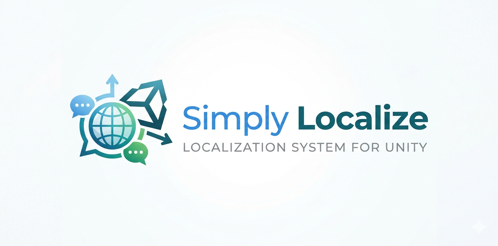

# Simply Localize



Simply Localize переводит текст и ассеты Unity. Меню и субтитры могут использовать один язык, а озвучка — другой. Для небольшой игры достаточно одного канала и одного набора контента.

[English](README.md) · [Журнал изменений](CHANGELOG_RU.md)

[Установка](#установка) · [Быстрый старт](#быстрый-старт) · [Окно](#окно-редактора) · [Runtime API](#runtime-api) · [Форматирование](#плюрализация-и-параметры) · [Обновление](#обновление-с-202)

## Установка

Руководство для **2.1.0**. OpenUPM устанавливает опубликованную версию. Для установки из локальной копии репозитория выберите **Package Manager → + → Install package from disk** и откройте `src/SimplyLocalize/package.json`.

### Через OpenUPM

**Вариант A — OpenUPM CLI** (рекомендуется):

```bash
npm install -g openupm-cli
openupm add com.renkoff.simply-localize
```

**Вариант B — вручную через `Packages/manifest.json`**:

1. Добавь scoped registry:

```json
{
  "scopedRegistries": [
    {
      "name": "OpenUPM",
      "url": "https://package.openupm.com",
      "scopes": [
        "com.renkoff"
      ]
    }
  ],
  "dependencies": {
    "com.renkoff.simply-localize": "2.1.0"
  }
}
```

### Через Package Manager (Git URL)

При установке из Git укажите подпапку пакета. Замените `<revision>` на опубликованный тег или коммит, доступный в вашем удалённом репозитории.

```text
https://github.com/RenKOFFF/Simply-Localize-Localization-System-for-Unity.git?path=/src/SimplyLocalize#<revision>
```

## Быстрый старт

1. Откройте **Window → Simply Localize → Localization Editor**. В Setup выберите языки, укажите основной и резервный и нажмите **Create localization**. Окно создаст `Assets/SimplyLocalize/Resources/SimplyLocalizeSettings.asset`.
2. Оставьте выбранными **Main / Common**. Во вкладке **Translations** добавьте ключ `Menu/Play`, заполните перевод для каждого языка и сохраните.
3. Добавьте `LocalizedText` на объект с TMP или обычным Text и выберите запись. В Play Mode переключите язык Main и проверьте обе надписи. Картинки и аудиоклипы настраиваются во вкладке **Assets**.
4. Готовый JSON или таблицу ассетов подключите через **Settings → Content sets → Connect a source**. Выберите язык и зарегистрируйте ключи. JSON можно редактировать в текстовом редакторе и перечитывать через **Reload from disk**.

**Канал** выбирает язык. **Набор контента** объединяет записи, которые загружаются вместе. Например, если озвучка только на английском, создайте независимый канал Voice с языком `en` и подключите к нему набор с клипами. Субтитры оставьте в Main с `en` и `ru`. Набор большой главы можно подключить к каналу и загружать при входе в главу.

### Формат JSON

```json
{
  "translations": {
    "UI/MainMenu/Play": "Играть",
    "UI/MainMenu/Quit": "Выход",
    "Game/Score": "Очки: {0}",
    "Game/Coins": "У вас {0} {0|монета|монеты|монет}",
    "Dialogue/Greeting": "Привет, {playerName}!"
  }
}
```

## Окно редактора

Окно редактирует один проектный конфиг. Для работы с контентом выбери канал и набор.
Этот редакторский выбор не переключает язык запущенной игры.
Setup начинает с Main/Common; независимые и FollowMain-каналы добавляются по необходимости.

### Таб Translations

Выбери запись в виртуализированном списке с поиском, затем редактируй переводы и
описание в панели деталей. Прямые значения отделены от результата fallback.
Save сохраняет черновик, Cancel отменяет правки. При переходе в другой контекст
окно предлагает сохранить, отменить переход или отбросить черновик.
Reload from disk перечитывает JSON после внешних правок.

Переименование и перенос сохраняют ID записи. Компоненты со ссылкой по ID не требуют
перезаписи сцен/префабов; строковый поиск продолжает зависеть от канала, набора и ключа.
Заметки привязаны к EntryId и лежат в
`Assets/SimplyLocalize/Editor/Notes/<GUID конфига>.json`, вне runtime Resources.
Конфликт или внешнее изменение останавливает сохранение устаревшего черновика.

### Таб Assets

Выбери зарегистрированную запись ассета, сравни прямые/fallback значения и превью,
назначь объекты по языкам. Создавай или подключай конкретные таблицы-источники.
Если таблиц несколько, место назначения выбирается явно. Изменения конфигурации и
ассетов сохраняются вместе, с откатом при ошибке и Unity Undo/Redo.

### Таб Languages

Ищи язык по названию или стандартному коду либо добавь custom-язык.
Доступные языки канала, default и fallback выбираются из каталога проекта.
Окно показывает встроенное, пользовательское или общее plural-правило; наличие
языка в каталоге не гарантирует отдельное правило или нужные символы в шрифте.
Источники регистрируются явно; удаление определения не удаляет файлы переводов молча.

### Таб Appearance

Идентичность языка отделена от оформления. Создавай или подключай источник
`LocalizationAppearance`, редактируй шрифты, типографику, интервалы и направление
в окне. Конфиг хранит адрес оформления, а не прямые ссылки на все шрифты.

### Таб Coverage

Проверка читает зарегистрированные источники выбранного канала/набора, различает
прямые, пустые, пробельные и fallback-значения, проверяет параметры и plural-формы.
Незарегистрированные ключи показываются отдельно. Ошибка или повреждённый источник
делает проверку неполной. Наличие ассета не доказывает соответствие типу любого
компонента. Состояние запущенной игры не меняется.

### Таб Auto Localize

Сканируй выбранные объекты TMP/Text, проверь ключи и привязки в предпросмотре, затем
применяй. Для prefab-объектов доступны пропуск, overrides экземпляров или изменение
prefab-ассетов. Компоненты получают ID записей; сцена и файлы участвуют в общем Undo.
После перезагрузки сборок ввод scan/CSV сохраняется, но требуется новый предпросмотр.

### Таб Tools

- Экспорт в CSV (для отправки в переводческие сервисы)
- Импорт из CSV с проверкой и предпросмотром изменений

CSV работает с выбранным каналом и набором. Минимальный заголовок — `Key,en,ru,...`.
Необязательные колонки `SetId`, `EntryId` и `Description` задают набор, сохраняют идентичность при
переименовании/переносе и содержат заметки. Экспорт включает ID. Колонки `Source:en` позволяют выбрать
уже подключённый источник, если файлов несколько. Старые колонка `File` и API `CsvExporter` удалены;
перед редактированием экспортируйте новый CSV. Автоматического переноса старых конфигов/профилей нет.

Поддерживаются запятые и экранированные кавычки внутри quoted-полей, многострочные значения, BOM
и переносы CR/LF/CRLF. Файл строго декодируется как UTF-8 либо UTF-16/UTF-32 с BOM. Пробелы в переводах
и описаниях сохраняются; ключи не могут начинаться/заканчиваться пробелом. Коды нормализуются
(`EN` → `en`, `pt-br` → `pt-BR`). Повторяющиеся нормализованные колонки, конфликты ID, повреждённые
строки и неподключённые назначения отменяют весь предпросмотр без записи данных.

Пустые ячейки **по умолчанию сохраняют прежние значения**; для удаления выберите явную очистку.
Отсутствующие языковые колонки и Description остаются без изменений. Проверьте предпросмотр
и примените его либо отмените без создания файлов и определений. Новый язык включается только
в выбранном канале. Внешняя правка делает предпросмотр устаревшим. После перезагрузки сборок
нужно построить его заново из сохранённого ввода.

Editor-скрипты используют `ProjectCsv.Export(config)` и `ProjectCsv.Preview(config, csv)`.
При отмене вызовите Dispose у плана. `plan.Apply()` сохраняет отдельную транзакцию и возвращает
`LocalizationProjectChange`. Для Unity Undo используйте
`LocalizationProjectUndo.Record(plan.Apply(), "Import CSV")`; окно Tools делает это автоматически.
Параметр `emptyCells: CsvEmptyCellPolicy.Clear` включает очистку. Заголовок без строк ничего не меняет;
пустой ввод считается ошибкой. Импорт не сохраняет отдельные незавершённые правки редактора.

Запись использует временные файлы и замену отдельных файлов. Перехваченная ошибка откатывает
предыдущие записи, включая конфиг и новые источники. Дополнительные поля JSON сохраняются.
После ошибки можно повторить применение, если причина устранима без изменения исходных данных
предпросмотра. Это не журнал восстановления после падения процесса или отключения питания;
при ошибке самого отката сообщение указывает сохранённые копии. Используйте Git или резервные копии.

### Таб Settings

- Автозапуск или явный bootstrap; определение языка устройства по желанию.
- Каналы, режим Independent/FollowMain, доступные наборы и наборы для старта.
- Регистрация точных источников; видимые стабильные ID без ручного редактирования.
- **Game View / Simulator language dropdown → Show in Play Mode** — отображение меню выбора языка в режиме Play Mode. В Game View меню расположено поверх изображения игры, в Device Simulator — в **Control Panel → Simply Localize**. Выбор языка доступен после инициализации локализации.
- **Game View position** — положение меню Game View: слева, по центру или справа.

### Таб Diagnostics

Показывает каналы runtime, владельцев загрузок, общие источники и состояние
загрузки/освобождения. Освобождение владения отделено от подтверждённого освобождения
физической памяти: снимок провайдера не учитывает все внешние ссылки и не заменяет
профилировщик памяти Unity.

## Runtime API

Статический класс читает данные основного канала Main. Перед первым чтением из игрового кода дождитесь инициализации. Компоненты интерфейса обновятся, когда данные загрузятся.

```csharp
using SimplyLocalize;
using System.Threading.Tasks;

public static class LanguageMenu
{
    public static async Task<string> SelectAsync(string language)
    {
        await Localization.InitializeAsync();
        await Localization.SetLanguageAsync(language);
        return Localization.Get("Menu/Play");
    }
}
```

Аудиоклип можно получить через `Localization.GetAsset<AudioClip>(key)`, перечитать источники через `Localization.ReloadAsync()`. `AvailableLanguages` возвращает коды языков. Для явного запуска назначьте `LocalizationProjectConfig` на Bootstrap. При использовании DI можно создать свой `LocalizationRuntime`, дождаться `InitializeAsync()` и вызвать `ReleaseAsync()` при завершении.

Чтобы переключить независимый канал, передайте его ID в `runtime.SwitchLanguageAsync(channelId, "en")`. При входе в главу сохраните результат `await runtime.AcquireSetAsync(channelId, setId)`. При выходе вызовите `await handle.ReleaseAsync()`. Если данные нужны ещё одному владельцу, он продолжит ими пользоваться.

## Компоненты

### LocalizedText

Локализует TextMeshPro или legacy `Text` компонент.

Выберите запись на компоненте, чтобы связать текст с каналом и набором.

### FormattableLocalizedText

То же что `LocalizedText`, но поддерживает параметры в runtime (индексированные и/или именованные).

```csharp
var text = GetComponent<FormattableLocalizedText>();

// Индексированные: в JSON "Очки: {0}"
text.SetArgs(100);
// или установить один индекс
text.SetArg(0, 100);

// Именованные: в JSON "Привет, {playerName}!"
text.SetParam("playerName", "Alex");

// Несколько именованных за раз
text.SetParams(new Dictionary<string, object>
{
    { "playerName", "Alex" },
    { "count", 5 }
});

// Очистить все параметры
text.ClearParams();
```

Дефолтные значения параметров можно задать в Inspector через список **Parameters** — удобно для статичных надписей с подстановками, для которых вообще не нужен код. Используй цифровое имя (`0`, `1`, ...) для индексированных параметров или любую строку для именованных.

### LocalizedSprite

Локализует Sprite на `Image` (UI) или `SpriteRenderer` (world-space). Сам определяет какой target лежит на том же GameObject.

### LocalizedAudioClip

Локализует AudioClip на `AudioSource`. Опционально — авто-проигрывание при смене языка (тоггл в инспекторе).

### LocalizedEvent

Вызывает разные `UnityEvent` в зависимости от языка. Полезно для аналитики, локализованных катсцен или любых language-specific сайд-эффектов.

### LocalizedProfileOverride

Для каждой записи на компоненте выберите код языка. Шрифт, типографика, интервалы и расположение можно переопределить для одного объекта. Общие настройки языка задаются во вкладке **Appearance**.

### Интеграция со Spine

Если установлен `com.esotericsoftware.spine.spine-unity`, Simply Localize автоматически включает
отдельные runtime/editor assembly интеграции. Spine остаётся необязательным и не добавляется в
dependencies пакета.

- `Localized Spine Attachment` заменяет один регион атласа локализованной `Texture2D`. Инспектор
  хранит цель как `Atlas Page + Region Path`, показывает превью для всех языков, проверяет размеры
  и настройки импорта, а также умеет вырезать исходный регион в папку `Localized/` как шаблон.
- `Localized Spine Texture` полностью заменяет одну страницу атласа. Для многостраничного skeleton
  страницу нужно выбрать явно и добавить отдельный компонент/ключ для каждой страницы с
  локализованной графикой. Инспектор проверяет принадлежность страницы, размеры, sampler settings,
  mipmaps и PMA.

Компоненты используют runtime skin или material overrides Spine и не изменяют общие
`SkeletonDataAsset`, материалы атласа и исходные текстуры. Если локализованный ассет отсутствует,
остаётся оригинальный контент. Полный workflow и правила для многостраничных атласов описаны в
[`Integrations/Spine/README.md`](src/SimplyLocalize/Integrations/Spine/README.md).

## Плюрализация и параметры

### Индексированные параметры

```json
"Score": "Ваш счёт: {0}"
```

```csharp
Localization.Get("Score", 100);  // "Ваш счёт: 100"
```

### Именованные параметры

```json
"Greeting": "Привет, {playerName}!"
```

```csharp
Localization.Get("Greeting",
    new Dictionary<string, object> { { "playerName", "Alex" } });
// "Привет, Alex!"
```

### Плюрализация

Синтаксис `{N|форма1|форма2|...}` выбирает форму на основе значения параметра `N` по правилу языка найденного перевода, в том числе при fallback.

```json
"Items": "{0} {0|item|items}",
"ItemsRu": "{0} {0|предмет|предмета|предметов}"
```

```csharp
Localization.Get("Items", 1);   // "1 item"
Localization.Get("Items", 5);   // "5 items"

// Русские правила (one / few / many):
Localization.Get("ItemsRu", 1); // "1 предмет"
Localization.Get("ItemsRu", 3); // "3 предмета"
Localization.Get("ItemsRu", 5); // "5 предметов"
```

### Plural-правила и совместимость

Для обычных чисел используются количественные правила [Unicode CLDR 48](https://www.unicode.org/cldr/charts/48/supplemental/language_plural_rules.html). В таблице указан **порядок позиций в шаблонах пакета**, а не порядок категорий CLDR. Прежние позиции сохраняются; дополнительные категории добавляются в конец.

| Коды языков | Формы по порядку в шаблоне |
|---|---|
| `en de nl sv fy fi et gl` | one, other |
| `af fo no nb nn ka tr hu` | one, other (включая дробную запись 1.0) |
| `da is` | one, other, с собственными правилами для дробей |
| `fr pt pt-BR` | one, other, **many** |
| `es it ca pt-PT` | one, other, **many** (разные условия для one) |
| `ru uk be pl` | one, few, many, **other** |
| `hr sr bs` | one, few, other |
| `cs sk` | one, few, other, **many** |
| `sl` | one, few, other, **two** |
| `ro` | one, other, **few** |
| `ja zh ko vi th id ms my lo km` | other |
| `ar` | zero, one, two, few, many, other |

Если форм недостаточно, используется последняя доступная. Например, французский `{0|pièce|pièces}` остаётся рабочим; форму many можно дописать третьей. Исправленные правила намеренно меняют ошибочный выбор, например для польского 21 и испанского 0. Для окситанского (`oc`) сохранено прежнее правило с двумя формами; неизвестные коды используют английское правило.

Правило определяется по коду языка найденного перевода, включая региональные варианты вроде `pt-PT`. Собственные правила `IPluralRule` можно зарегистрировать в `LocalizationPluralRules` и передать в форматтер своего runtime.

Встроенные правила принимают стандартные целочисленные типы и дроби без переполнения Int32. Чтобы сохранить число знаков после запятой, передавайте `decimal` или числовую строку с точкой: для `1m` и `1.0m` правила могут отличаться. Float/double используют точную обратимую десятичную запись. Отсутствующие, нечисловые, бесконечные значения, NaN и числа за пределами Decimal используют прежнее значение по умолчанию — ноль. Старые реализации `IPluralRule.Evaluate(int)` работают без изменений: дроби усекаются, большие значения ограничиваются диапазоном Int32. Для полного поддерживаемого диапазона есть дополнительный интерфейс `IDecimalPluralRule`. Правила порядковых чисел, диапазонов и сокращённой записи с показателем степени не поддерживаются.

### Явный выбор формы и обработка шаблонов

Обычные числовые параметры сохраняют plural-семантику. Для выбора по индексу передайте `FormSelector`, оставив текст шаблона прежним:

```csharp
using SimplyLocalize.TextProcessing;
// Перевод: "{gender|Он|Она} играет за {0|воина|мага|разбойника}"
Localization.Get("Character", new object[] { new FormSelector(2) },
    new Dictionary<string, object> { ["gender"] = new FormSelector(1) });
// "Она играет за разбойника", независимо от языка
```

Индексы начинаются с нуля; выход за границы выбирает первую или последнюю форму. Экранирование `{{` и `}}` работает во всех перегрузках `Get`, в том числе внутри текста форм. Для совместимости три закрывающие скобки сначала завершают токен, затем добавляют литеральную `}`: `{0|one|other}}}` при значении 1 даёт `one}`. Не найденные простые параметры сохраняют исходное написание. Повреждённые и вложенные конструкции остаются текстом: рекурсивные выражения, выравнивание и спецификаторы `string.Format` не входят в этот синтаксис. Значения параметров не разбираются повторно как шаблоны.

## Расширяемость

### Свои рендереры превью ассетов

Хочешь 3D-превью для локализованных мешей? Waveform для аудиоклипов? Имплементируй `IAssetPreviewRenderer` где угодно в Editor-коде — он будет автоматически обнаружен через `TypeCache`.

```csharp
using SimplyLocalize.Editor.AssetPreviews;
using UnityEditor;
using UnityEngine;

public class MeshPreviewRenderer : IAssetPreviewRenderer
{
    public int Priority => 10;

    public bool CanRender(Object asset) => asset is Mesh;

    public void DrawPreview(Rect rect, Object asset)
    {
        var mesh = (Mesh)asset;
        var preview = AssetPreview.GetAssetPreview(mesh);
        if (preview != null)
            GUI.DrawTexture(rect, preview, ScaleMode.ScaleToFit);
    }
}
```

Более высокий `Priority` побеждает если несколько рендереров могут отрисовать один тип. Встроенные sprite/texture/audio рендереры используют priority `10`, так что любая пользовательская реализация с priority `11+` их перекроет.

### Свои фильтры типов ассетов

Dropdown в табе Assets строится из обнаруженных реализаций `IAssetTypeFilter` плюс автогенерируемых фильтров для всех типов которые есть в твоих таблицах. Обычно своих писать не нужно — автогенератор использует `ObjectNames.NicifyVariableName` для display-имён. Но если хочешь имя получше дефолтного (например, "UI Icons" вместо "Sprite") — реализуй интерфейс:

```csharp
using System;
using System.Collections.Generic;
using SimplyLocalize;
using SimplyLocalize.Editor.AssetFilters;
using UnityEngine;

public class UIIconFilter : IAssetTypeFilter
{
    public string DisplayName => "UI Icons";
    public int Order => 5;
    public Type AcceptedFieldType => typeof(Sprite);

    public bool MatchesKey(string key, IReadOnlyDictionary<string, LocalizationAssetTable> tables)
    {
        if (!key.StartsWith("ui/icons/")) return false;

        foreach (var t in tables.Values)
        {
            if (t == null) continue;
            var a = t.Get(key);
            if (a == null) continue;
            if (a is Sprite) return true;
        }
        return true; // показываем неназначенные ключи чтобы не пропадали
    }
}
```

### Свои табы редактора

Добавь свой таб в окно локализации:

```csharp
using SimplyLocalize.Editor;
using SimplyLocalize.Editor.Windows.Tabs;
using UnityEngine.UIElements;

[LocalizationEditorTab("Glossary", order: 50)]
public class GlossaryTab : IEditorTab
{
    public void Build(VisualElement container)
    {
        container.Add(new Label("Мой кастомный таб!"));
        // ... твой UI здесь
    }
}
```

Таб появится в баре табов автоматически, отсортированным по `order`. Регистрация не нужна.

### Свой источник данных

Реализуйте `ILocalizationSourceProvider` в проекте игры, зарегистрируйте его под своим ID в `LocalizationSourceRegistry` и передайте реестр в `Localization.InitializeAsync(config, providers: registry)`. Каждая успешная загрузка возвращает `LocalizationSourceLease` с действием для освобождения данных. Для встроенного Resources дополнительный код не требуется. Обязательных зависимостей от Addressables и AssetBundle нет. Игра, которая хранит переводы в Addressables, может подключить свой провайдер.

## Атрибуты

### `[LocalizationKey]`

Превращает поле `string` в поисковый key picker в инспекторе.

```csharp
using SimplyLocalize;

public class DialogueLine : MonoBehaviour
{
    [LocalizationKey] public string key;
}
```

### `[LocalizationPreview]`

Показывает live-превью разрешённого перевода рядом с полем `[LocalizationKey]`.

```csharp
[LocalizationKey]
[LocalizationPreview]
public string key;
```

### `[LocalizationEditorTab(name, order)]`

Регистрирует класс как кастомный таб в окне локализации. Класс должен реализовывать `IEditorTab`.

---

## Обновление с 2.0.2

**В 2.1.0 есть несовместимые изменения.** Перед обновлением сохраните копию проекта и выпишите настройки профилей, языков, fallback и пути к источникам. Если игровые скрипты используют удалённые типы, сначала исправьте ошибки компиляции, чтобы открылось окно редактора.

- Создайте конфиг в Setup и подключите старые JSON и таблицы ассетов. Уникальные строковые ключи в Main можно оставить. При переносе записи в другой канал явно выберите её на компоненте.
- В каждом явно используемом `LocalizationBootstrap` назначьте новый конфиг и язык. Общие настройки шрифтов перенесите в Appearance. В старых записях `LocalizedProfileOverride` и `LocalizedEvent` заново выберите язык.
- Замените `Localization.SetLanguage("ru")` на `await Localization.SetLanguageAsync("ru")`. Свои провайдеры перенесите на реестр источников. Если в старом CSV есть колонка `File`, экспортируйте новый шаблон.

[Пошаговый переход](docs/channel-architecture/UPGRADE.md) · [Примеры каналов и наборов](docs/channel-architecture/WINDOW_GUIDE.md)

[Окно прежней версии (GIF)](docs/images/editor-overview.gif)

## Настройка из кода Editor и автоматизация

```csharp
var result = SimplyLocalize.Editor.LocalizationProjectAuthoring.Configure(
    new[] { "en", "ru" }, "en", "en");
// result.Config; result.Change при обновлении существующего стартового конфига
```

Метод доступен в Editor без диалогов. Configure явно работает с фиксированным стартовым путём. Повторный вызов сохраняет ID, существующие названия, флаги запуска и файлы переводов; переданные default/fallback применяются к Main. Чтобы использовать конфиг из другого места, вызови `LocalizationProjectAuthoring.UseForAutomaticStartup(config)`. `LocalizationProjectAuthoring.AddLanguage(config, "pl")` добавляет язык без смены default; независимые каналы настраиваются явно. JSON можно редактировать вне Unity, затем обновить снимок редактора. Ручные правки конфига сначала нужно сохранить. Конфликт или неверный ввод вызывают исключение без частичной настройки. Проверка перед сборкой валидирует адрес, тип и настройки стартового конфига; она не запускает провайдеры и не требует стартового конфига при явном bootstrap.

```text
Unity -batchmode -quit -projectPath <project>
  -executeMethod SimplyLocalize.Editor.LocalizationProjectAuthoring.ConfigureFromCommandLine
  -slLanguages en,ru -slDefault en -slFallback en
```

## Лицензия

MIT — см. [LICENSE.txt](LICENSE.txt).

## Контрибьюция

Issues и pull requests приветствуются на [github.com/RenKOFFF/Simply-Localize-Localization-System-for-Unity](https://github.com/RenKOFFF/Simply-Localize-Localization-System-for-Unity).
