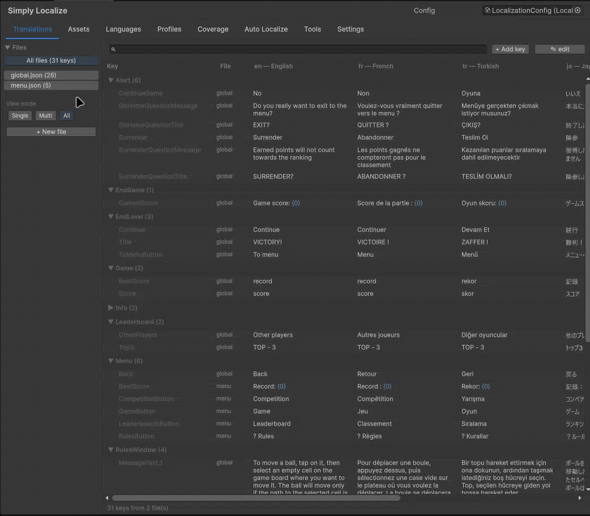

# Simply Localize


Современная гибкая система локализации для Unity. Управляет переводами, локализованными ассетами (спрайты, звуки, любые `UnityEngine.Object`), шрифтами для разных языков, плюрализацией, переключением языка во время игры и удобным редактором — всё без внешних зависимостей.

*На других языках: [English](README.md).*

Эта ветка разработки переходит на один проектный конфиг с каналами. Ниже обновлено
описание окна; прежние runtime-примеры и инструкции по профилям в других разделах
README ещё заменяются. Для этой ветки используй актуальные
[описание API C4](docs/channel-architecture/C4.md) и [редактор C5](docs/channel-architecture/C5.md).

Проект разработки: [playgrounds/SimplyLocalize-Lab](playgrounds/SimplyLocalize-Lab/README-LAB.md), Unity 6000.0.62f1. Плагин подключён из `src/SimplyLocalize` локальным UPM-пакетом. Новые файлы сохраняются в Git вместе с созданными Unity `.meta`. Структура и доказательства проверки — в [нумерованном отчёте переноса](docs/project-structure/0001-local-package-migration/REPORT.md).

---

## Содержание

- [Возможности](#возможности)
- [Установка](#установка)
  - [Через OpenUPM](#через-openupm)
  - [Через Package Manager (Git URL)](#через-package-manager-git-url)
  - [Через manifest.json](#через-manifestjson)
- [Быстрый старт](#быстрый-старт)
- [Структура папок](#структура-папок)
- [Окно редактора](#окно-редактора)
- [Runtime API](#runtime-api)
- [Компоненты](#компоненты)
- [Интеграция со Spine](#интеграция-со-spine)
- [Плюрализация и параметры](#плюрализация-и-параметры)
- [Профили языков и шрифты](#профили-языков-и-шрифты)
- [Цепочки fallback'ов](#цепочки-fallbackов)
- [Локализованные ассеты](#локализованные-ассеты)
- [Dependency Injection](#dependency-injection)
- [Расширяемость](#расширяемость)
- [Атрибуты](#атрибуты)
- [Миграция с v1](#миграция-с-v1)

---

## Возможности

- **Локализация текста** — JSON, по одной папке на язык, несколько файлов на язык объединяются автоматически
- **Локализация ассетов** — спрайты, аудио, материалы, префабы или любой `UnityEngine.Object` через таблицы ассетов; единый runtime-API `Localization.GetAsset<T>(key)` для всех типов
- **Плюрализация** — встроенные правила для германских, славянских, романских, восточноазиатских и арабского языков, через простой inline-синтаксис (`{0|яблоко|яблока|яблок}`)
- **Подстановка параметров** — индексированные (`{0}`), именованные (`{playerName}`) или смешанные
- **Профили языков** — на каждый язык: TMP-шрифт + fallback-шрифт, legacy-шрифт, множитель размера, толщина, межсимвольный/межстрочный/межсловный интервал, направление текста (LTR/RTL), переопределение выравнивания
- **Per-language fallback chain** — например, `украинский → русский → английский`; каждый профиль указывает на свой fallback, обход с защитой от циклов
- **Per-component override профилей** — отдельные UI-элементы могут переопределять конкретные секции (только шрифт, только spacing и т.д.) из глобального профиля
- **Переключение языка во время игры** — один вызов обновляет все активные компоненты через события
- **Опциональная интеграция со Spine** — локализация отдельных attachments или полная замена страниц атласа без изменения общих Spine-ассетов
- **Богатый редактор** — виртуализированная таблица переводов, поиск, drag-and-drop таблиц ассетов, inline-превью, undo/redo, переименование ключей с автообновлением ссылок в сценах и префабах, анализ покрытия, экспорт в CSV
- **Расширяемость** — кастомные рендереры превью и фильтры типов через простые интерфейсы + `TypeCache`-обнаружение; кастомные табы через атрибут `[LocalizationEditorTab]`
- **DI-friendly** — статический фасад `Localization` для простоты или прямая инъекция `LocalizationManager` для тестируемости
- **WebGL** — встроенный мост для логирования
- **Без сторонних пакетов** — чистый C#

---

## Установка

### Через OpenUPM

**Вариант A — OpenUPM CLI** (рекомендуется):

```bash
npm install -g openupm-cli
openupm add com.renkoff.simply-localize
```

**Вариант B — вручную через `Packages/manifest.json`**:

1. Добавь scoped registry:

```json
{
  "scopedRegistries": [
    {
      "name": "OpenUPM",
      "url": "https://package.openupm.com",
      "scopes": [
        "com.renkoff"
      ]
    }
  ],
  "dependencies": {
    "com.renkoff.simply-localize": "2.0.1"
  }
}
```

### Через Package Manager (Git URL)

1. Открой `Window → Package Manager`
2. Нажми `+ → Add package from git URL`
3. Вставь:

```
https://github.com/RenKOFFF/Simply-Localize-Localization-System-for-Unity.git?path=src/SimplyLocalize
```

### Через manifest.json

Добавь в `Packages/manifest.json`:

```json
{
  "dependencies": {
    "com.renkoff.simply-localize": "https://github.com/RenKOFFF/Simply-Localize-Localization-System-for-Unity.git?path=src/SimplyLocalize"
  }
}
```

---

## Быстрый старт

### 1. Создай Localization Config

`Create → SimplyLocalize → Localization Config`

Для настройки открой окно Simply Localize и нажми **Set up localization**. Стартовый конфиг создаётся в `Assets/SimplyLocalize/Resources/SimplyLocalizeSettings.asset`. В Inspector добавь языки кнопкой **Add languages and missing files**, выбери основной язык/fallback и включи Auto Initialize. Для существующего конфига используй **Use for automatic startup**.

### 2. Создай Language Profiles

`Create → SimplyLocalize → Language Profile` для каждого языка (English, Russian, Japanese и т.д.)

Заполни поля `languageCode`, `displayName`, `systemLanguage` и добавь профиль в список `LocalizationConfig.languages`.

> **Совет:** Языки можно создавать прямо из окна редактора через таб **Languages** — оно само сгенерирует структуру папок и JSON-файлы.

### 3. Открой окно редактора

`Window → SimplyLocalize → Localization Editor`

В окне 8 табов: **Translations**, **Assets**, **Languages**, **Profiles**, **Coverage**, **Auto Localize**, **Tools**, **Settings**.


<!-- TODO: добавить скриншот -->

### 4. Добавь первые ключи

В табе **Translations**:
- Нажми **`+ Add key`** в тулбаре
- Введи ключ (например, `UI/MainMenu/Play`) и выбери файл
- Заполни переводы для всех языков inline в таблице

### 5. Инициализация в runtime

```csharp
using SimplyLocalize;
using UnityEngine;

public class GameBootstrap : MonoBehaviour
{
    [SerializeField] private LocalizationConfig _config;

    private void Awake()
    {
        // Инициализация с явным конфигом
        Localization.Initialize(_config);

        // Или авто-определение системного языка
        Localization.SetLanguageAuto();
    }
}
```

Альтернатива — включи **Auto Initialize** в ассете `LocalizationConfig`, и система загрузится сама из `Resources` ещё до загрузки сцены.

### 6. Используй

```csharp
string greeting = Localization.Get("UI/Welcome");
string score = Localization.Get("UI/Score", 100);
Sprite flag = Localization.GetAsset<Sprite>("flags/current");
```

Или просто кинь компонент `LocalizedText` на любой TextMeshPro / legacy Text и выбери ключ в Inspector — без кода.

Владение при запуске: bootstrap-компоненты сохраняют первый успешно созданный менеджер. Дубликаты не сбрасывают менеджер и выбранный язык; конфликт конфигов сопровождается предупреждением. При уничтожении выключить актуальный менеджер может только bootstrap, который его создал. `DontDestroyOnLoad` сохраняет этого владельца между сценами. Ручная и автоматическая инициализация не передают владение последующим bootstrap. Для явной замены используй `Localization.Initialize(config, ...)`: ошибка проверки или загрузки сохраняет прежний рабочий менеджер. Обычные `Shutdown()` и повторная инициализация сохраняют подписчиков статического API и отключают пересылку событий старого менеджера.

Каждый новый запуск Play Mode сбрасывает статический менеджер, события API и зарегистрированные plural-правила, в том числе при выключенном Domain Reload (проверено с включённым Scene Reload). Пользовательские правила регистрируй заново при запуске, после subsystem registration. Одновременное отключение Domain Reload и Scene Reload не входит в проверенную матрицу. Проверка конфигурации выявляет повторяющиеся коды, конфликтующие ссылки на профили, недопустимые коды/пути и default-профиль вне `languages`. Пустые элементы пропускаются; внешние fallback-профили и цепочки с защитой от циклов остаются допустимыми. Метод `GetValidationErrors()` проверяет конфиг без его изменения. Если default не задан, язык нужно выбрать явно. Автозапуск рассматривает только конфиги с `autoInitialize`; при нескольких кандидатах сообщает об ошибке вместо случайного выбора.

---

## Структура папок

Локализационные данные лежат в любой папке `Resources`:

```
Assets/
└── Resources/
    └── Localization/        ← базовый путь (настраивается в LocalizationConfig)
        ├── _meta.json       ← метаданные ключей (описания, история переименований)
        ├── en/
        │   ├── text/
        │   │   ├── global.json
        │   │   ├── ui.json
        │   │   └── items.json
        │   └── AssetTable.asset    ← локализованные спрайты/звуки/etc для английского
        ├── ru/
        │   ├── text/
        │   │   ├── global.json
        │   │   ├── ui.json
        │   │   └── items.json
        │   └── AssetTable.asset
        └── ja/
            ├── text/
            │   └── ...
            └── AssetTable.asset
```

Несколько JSON-файлов на один язык **объединяются** при загрузке — разделяй ключи по фичам (ui.json, items.json, dialogue.json и т.д.) для лучшей организации и удобства мерджа в системе контроля версий.

### Формат JSON

```json
{
  "translations": {
    "UI/MainMenu/Play": "Играть",
    "UI/MainMenu/Quit": "Выход",
    "Game/Score": "Очки: {0}",
    "Game/Coins": "У вас {0} {0|монета|монеты|монет}",
    "Dialogue/Greeting": "Привет, {playerName}!"
  }
}
```

---

## Окно редактора

Окно редактирует один проектный конфиг. Для работы с контентом выбери канал и набор.
Этот редакторский выбор не переключает язык запущенной игры.
Setup начинает с Main/Common; независимые и FollowMain-каналы добавляются по необходимости.

### Таб Translations

Выбери запись в виртуализированном списке с поиском, затем редактируй переводы и
описание в панели деталей. Прямые значения отделены от результата fallback.
Save сохраняет черновик, Cancel отменяет правки. При переходе в другой контекст
окно предлагает сохранить, отменить переход или отбросить черновик.
Reload from disk перечитывает JSON после внешних правок.

Переименование и перенос сохраняют ID записи. Компоненты со ссылкой по ID не требуют
перезаписи сцен/префабов; строковый поиск продолжает зависеть от канала, набора и ключа.
Заметки привязаны к EntryId и лежат в
`Assets/SimplyLocalize/Editor/Notes/<GUID конфига>.json`, вне runtime Resources.
Конфликт или внешнее изменение останавливает сохранение устаревшего черновика.

### Таб Assets

Выбери зарегистрированную запись ассета, сравни прямые/fallback значения и превью,
назначь объекты по языкам. Создавай или подключай конкретные таблицы-источники.
Если таблиц несколько, место назначения выбирается явно. Изменения конфигурации и
ассетов сохраняются вместе, с откатом при ошибке и Unity Undo/Redo.

### Таб Languages

Ищи язык по названию или стандартному коду либо добавь custom-язык.
Доступные языки канала, default и fallback выбираются из каталога проекта.
Окно показывает встроенное, пользовательское или общее plural-правило; наличие
языка в каталоге не гарантирует отдельное правило или нужные символы в шрифте.
Источники регистрируются явно; удаление определения не удаляет файлы переводов молча.

### Таб Appearance

Идентичность языка отделена от оформления. Создавай или подключай источник
`LocalizationAppearance`, редактируй шрифты, типографику, интервалы и направление
в окне. Конфиг хранит адрес оформления, а не прямые ссылки на все шрифты.

### Таб Coverage

Проверка читает зарегистрированные источники выбранного канала/набора, различает
прямые, пустые, пробельные и fallback-значения, проверяет параметры и plural-формы.
Незарегистрированные ключи показываются отдельно. Ошибка или повреждённый источник
делает проверку неполной. Наличие ассета не доказывает соответствие типу любого
компонента. Состояние запущенной игры не меняется.

### Таб Auto Localize

Сканируй выбранные объекты TMP/Text, проверь ключи и привязки в предпросмотре, затем
применяй. Для prefab-объектов доступны пропуск, overrides экземпляров или изменение
prefab-ассетов. Компоненты получают ID записей; сцена и файлы участвуют в общем Undo.
После перезагрузки сборок ввод scan/CSV сохраняется, но требуется новый предпросмотр.

### Таб Tools

- Экспорт в CSV (для отправки в переводческие сервисы)
- Импорт из CSV с проверкой и предпросмотром изменений

CSV работает с выбранным каналом и набором. Минимальный заголовок — `Key,en,ru,...`.
Необязательные колонки `SetId`, `EntryId` и `Description` задают набор, сохраняют идентичность при
переименовании/переносе и содержат заметки. Экспорт включает ID. Колонки `Source:en` позволяют выбрать
уже подключённый источник, если файлов несколько. Старые колонка `File` и API `CsvExporter` удалены;
перед редактированием экспортируйте новый CSV. Автоматического переноса старых конфигов/профилей нет.

Поддерживаются запятые и экранированные кавычки внутри quoted-полей, многострочные значения, BOM
и переносы CR/LF/CRLF. Файл строго декодируется как UTF-8 либо UTF-16/UTF-32 с BOM. Пробелы в переводах
и описаниях сохраняются; ключи не могут начинаться/заканчиваться пробелом. Коды нормализуются
(`EN` → `en`, `pt-br` → `pt-BR`). Повторяющиеся нормализованные колонки, конфликты ID, повреждённые
строки и неподключённые назначения отменяют весь предпросмотр без записи данных.

Пустые ячейки **по умолчанию сохраняют прежние значения**; для удаления выберите явную очистку.
Отсутствующие языковые колонки и Description остаются без изменений. Проверьте предпросмотр
и примените его либо отмените без создания файлов и определений. Новый язык включается только
в выбранном канале. Внешняя правка делает предпросмотр устаревшим. После перезагрузки сборок
нужно построить его заново из сохранённого ввода.

Editor-скрипты используют `ProjectCsv.Export(config)` и `ProjectCsv.Preview(config, csv)`.
При отмене вызовите Dispose у плана. `plan.Apply()` сохраняет отдельную транзакцию и возвращает
`LocalizationProjectChange`. Для Unity Undo используйте
`LocalizationProjectUndo.Record(plan.Apply(), "Import CSV")`; окно Tools делает это автоматически.
Параметр `emptyCells: CsvEmptyCellPolicy.Clear` включает очистку. Заголовок без строк ничего не меняет;
пустой ввод считается ошибкой. Импорт не сохраняет отдельные незавершённые правки редактора.

Запись использует временные файлы и замену отдельных файлов. Перехваченная ошибка откатывает
предыдущие записи, включая конфиг и новые источники. Дополнительные поля JSON сохраняются.
После ошибки можно повторить применение, если причина устранима без изменения исходных данных
предпросмотра. Это не журнал восстановления после падения процесса или отключения питания;
при ошибке самого отката сообщение указывает сохранённые копии. Используйте Git или резервные копии.

### Таб Settings

- Автозапуск или явный bootstrap; определение языка устройства по желанию.
- Каналы, режим Independent/FollowMain, доступные наборы и наборы для старта.
- Регистрация точных источников; видимые стабильные ID без ручного редактирования.
- **Game View / Simulator language dropdown → Show in Play Mode** — отображение меню выбора языка в режиме Play Mode. В Game View меню расположено поверх изображения игры, в Device Simulator — в **Control Panel → Simply Localize**. Выбор языка доступен после инициализации локализации.
- **Game View position** — положение меню Game View: слева, по центру или справа.

### Таб Diagnostics

Показывает каналы runtime, владельцев загрузок, общие источники и состояние
загрузки/освобождения. Освобождение владения отделено от подтверждённого освобождения
физической памяти: снимок провайдера не учитывает все внешние ссылки и не заменяет
профилировщик памяти Unity.

---

## Runtime API

### Статический фасад (самый простой способ)

```csharp
using SimplyLocalize;

// Инициализация
Localization.Initialize(config);                    // явный конфиг
Localization.Initialize(config, "ru");              // явный язык
Localization.Initialize();                          // авто-поиск в Resources
Localization.SetLanguageAuto();                     // подобрать под язык устройства

// Текст
string s1 = Localization.Get("UI/Welcome");
string s2 = Localization.Get("UI/Score", 100);
string s3 = Localization.Get("UI/Stats",
    new object[] { 10, 20 },
    new Dictionary<string, object> { { "playerName", "Alex" } });

// Ассеты (generic, работает для ЛЮБОГО UnityEngine.Object)
Sprite flag = Localization.GetAsset<Sprite>("flags/current");
AudioClip voice = Localization.GetAsset<AudioClip>("voice/intro");
Material mat = Localization.GetAsset<Material>("fx/hit");
AnimationClip anim = Localization.GetAsset<AnimationClip>("anim/idle");

// Переключение языка
Localization.SetLanguage("ru");
Localization.SetLanguage(russianProfile);

// Запросы
bool exists = Localization.HasKey("UI/Welcome");
bool hasRu = Localization.HasTranslation("UI/Welcome", "ru");
string current = Localization.CurrentLanguage;
LanguageProfile profile = Localization.CurrentProfile;

// События
Localization.OnLanguageChanged += OnLangChanged;
Localization.OnProfileChanged += OnProfileChanged;

// Shutdown и перезагрузка
Localization.Shutdown();
Localization.Reload();
```

### Instance API (для DI и тестов)

См. [Dependency Injection](#dependency-injection).

---

## Компоненты

### LocalizedText

Локализует TextMeshPro или legacy `Text` компонент.

1. Добавь `LocalizedText` на GameObject где есть text-компонент
2. Выбери ключ из dropdown'а (поисковый popup со всеми доступными ключами)
3. Готово — текст автоматически обновляется при смене языка

```csharp
// Опционально: смена ключа из кода
GetComponent<LocalizedText>().Key = "UI/NewKey";
```

### FormattableLocalizedText

То же что `LocalizedText`, но поддерживает параметры в runtime (индексированные и/или именованные).

```csharp
var text = GetComponent<FormattableLocalizedText>();

// Индексированные: в JSON "Очки: {0}"
text.SetArgs(100);
// или установить один индекс
text.SetArg(0, 100);

// Именованные: в JSON "Привет, {playerName}!"
text.SetParam("playerName", "Alex");

// Несколько именованных за раз
text.SetParams(new Dictionary<string, object>
{
    { "playerName", "Alex" },
    { "count", 5 }
});

// Очистить все параметры
text.ClearParams();
```

Дефолтные значения параметров можно задать в Inspector через список **Parameters** — удобно для статичных надписей с подстановками, для которых вообще не нужен код. Используй цифровое имя (`0`, `1`, ...) для индексированных параметров или любую строку для именованных.

### LocalizedSprite

Локализует Sprite на `Image` (UI) или `SpriteRenderer` (world-space). Сам определяет какой target лежит на том же GameObject.

### LocalizedAudioClip

Локализует AudioClip на `AudioSource`. Опционально — авто-проигрывание при смене языка (тоггл в инспекторе).

### LocalizedEvent

Вызывает разные `UnityEvent` в зависимости от языка. Полезно для аналитики, локализованных катсцен или любых language-specific сайд-эффектов.

### LocalizedProfileOverride

Переопределяет конкретные секции глобального `LanguageProfile` для отдельного компонента. Полезно когда, например, нужен один конкретный заголовок с увеличенным шрифтом для китайского, но без затрагивания остальных языков.

Секции, которые можно переопределить независимо: **Font**, **Typography**, **Spacing**, **Layout**. У каждой свой per-language список плюс тоггл включения/выключения.

### Интеграция со Spine

Если установлен `com.esotericsoftware.spine.spine-unity`, Simply Localize автоматически включает
отдельные runtime/editor assembly интеграции. Spine остаётся необязательным и не добавляется в
dependencies пакета.

- `Localized Spine Attachment` заменяет один регион атласа локализованной `Texture2D`. Инспектор
  хранит цель как `Atlas Page + Region Path`, показывает превью для всех языков, проверяет размеры
  и настройки импорта, а также умеет вырезать исходный регион в папку `Localized/` как шаблон.
- `Localized Spine Texture` полностью заменяет одну страницу атласа. Для многостраничного skeleton
  страницу нужно выбрать явно и добавить отдельный компонент/ключ для каждой страницы с
  локализованной графикой. Инспектор проверяет принадлежность страницы, размеры, sampler settings,
  mipmaps и PMA.

Компоненты используют runtime skin или material overrides Spine и не изменяют общие
`SkeletonDataAsset`, материалы атласа и исходные текстуры. Если локализованный ассет отсутствует,
остаётся оригинальный контент. Полный workflow и правила для многостраничных атласов описаны в
[`Integrations/Spine/README.md`](src/SimplyLocalize/Integrations/Spine/README.md).

### Свой локализованный компонент

Если нужно локализовать свой тип ассета — наследуйся от `LocalizedAsset<T>`:

```csharp
using SimplyLocalize;
using SimplyLocalize.Components;
using UnityEngine;

[DisallowMultipleComponent]
public class LocalizedMaterial : LocalizedAsset<Material>
{
    [SerializeField] private Renderer _target;

    protected override void ApplyAsset(Material asset)
    {
        if (_target != null) _target.material = asset;
    }

    protected override Material ReadCurrentAsset()
    {
        return _target != null ? _target.material : null;
    }
}
```

И всё — базовый класс сам подписывается на событие смены языка, делает первоначальную загрузку и переприменяет ассет при переключениях. Селектор ключа в инспекторе автоматически отфильтрует только ключи с типом `Material` в твоих таблицах.

---

## Плюрализация и параметры

### Индексированные параметры

```json
"Score": "Ваш счёт: {0}"
```

```csharp
Localization.Get("Score", 100);  // "Ваш счёт: 100"
```

### Именованные параметры

```json
"Greeting": "Привет, {playerName}!"
```

```csharp
Localization.Get("Greeting",
    new Dictionary<string, object> { { "playerName", "Alex" } });
// "Привет, Alex!"
```

### Плюрализация

Синтаксис `{N|форма1|форма2|...}` выбирает форму на основе значения параметра `N` по правилу языка найденного перевода, в том числе при fallback.

```json
"Items": "{0} {0|item|items}",
"ItemsRu": "{0} {0|предмет|предмета|предметов}"
```

```csharp
Localization.Get("Items", 1);   // "1 item"
Localization.Get("Items", 5);   // "5 items"

// Русские правила (one / few / many):
Localization.Get("ItemsRu", 1); // "1 предмет"
Localization.Get("ItemsRu", 3); // "3 предмета"
Localization.Get("ItemsRu", 5); // "5 предметов"
```

### Plural-правила и совместимость

Для обычных чисел используются количественные правила [Unicode CLDR 48](https://www.unicode.org/cldr/charts/48/supplemental/language_plural_rules.html). В таблице указан **порядок позиций в шаблонах пакета**, а не порядок категорий CLDR. Прежние позиции сохраняются; дополнительные категории добавляются в конец.

| Коды языков | Формы по порядку в шаблоне |
|---|---|
| `en de nl sv fy fi et gl` | one, other |
| `af fo no nb nn ka tr hu` | one, other (включая дробную запись 1.0) |
| `da is` | one, other, с собственными правилами для дробей |
| `fr pt pt-BR` | one, other, **many** |
| `es it ca pt-PT` | one, other, **many** (разные условия для one) |
| `ru uk be pl` | one, few, many, **other** |
| `hr sr bs` | one, few, other |
| `cs sk` | one, few, other, **many** |
| `sl` | one, few, other, **two** |
| `ro` | one, other, **few** |
| `ja zh ko vi th id ms my lo km` | other |
| `ar` | zero, one, two, few, many, other |

Миграция JSON и ассетов не нужна. Если форм недостаточно, используется последняя доступная. Например, французский `{0|pièce|pièces}` остаётся рабочим; форму many можно дописать третьей. Исправленные правила намеренно меняют ошибочный выбор, например для польского 21 и испанского 0. Для окситанского (`oc`) сохранено прежнее правило с двумя формами; неизвестные коды используют английское правило.

Правило определяется по `LanguageProfile.languageCode`, включая регион (`pt-PT` отличается от `pt-BR`). Поле `systemLanguage` служит для определения языка устройства. Регистр кода не важен, `_` эквивалентен `-`. Пользовательское правило `IPluralRule`, зарегистрированное через `PluralRuleProvider.RegisterRule`, применяется к коду и его региональным вариантам, если для них нет отдельного переопределения. Регистрация сбрасывает кэш выбранных правил.

Встроенные правила принимают стандартные целочисленные типы и дроби без переполнения Int32. Чтобы сохранить число знаков после запятой, передавайте `decimal` или числовую строку с точкой: для `1m` и `1.0m` правила могут отличаться. Float/double используют точную обратимую десятичную запись. Отсутствующие, нечисловые, бесконечные значения, NaN и числа за пределами Decimal используют прежнее значение по умолчанию — ноль. Старые реализации `IPluralRule.Evaluate(int)` работают без изменений: дроби усекаются, большие значения ограничиваются диапазоном Int32. Для полного поддерживаемого диапазона есть дополнительный интерфейс `IDecimalPluralRule`. Правила порядковых чисел, диапазонов и сокращённой записи с показателем степени не поддерживаются.

### Явный выбор формы и обработка шаблонов

Обычные числовые параметры сохраняют plural-семантику. Для выбора по индексу передайте `FormSelector`, оставив текст шаблона прежним:

```csharp
using SimplyLocalize.TextProcessing;
// Перевод: "{gender|Он|Она} играет за {0|воина|мага|разбойника}"
Localization.Get("Character", new object[] { new FormSelector(2) },
    new Dictionary<string, object> { ["gender"] = new FormSelector(1) });
// "Она играет за разбойника", независимо от языка
```

Индексы начинаются с нуля; выход за границы выбирает первую или последнюю форму. Экранирование `{{` и `}}` работает во всех перегрузках `Get`, в том числе внутри текста форм. Для совместимости три закрывающие скобки сначала завершают токен, затем добавляют литеральную `}`: `{0|one|other}}}` при значении 1 даёт `one}`. Не найденные простые параметры сохраняют исходное написание. Повреждённые и вложенные конструкции остаются текстом: рекурсивные выражения, выравнивание и спецификаторы `string.Format` не входят в этот синтаксис. Значения параметров не разбираются повторно как шаблоны.

---

## Профили языков и шрифты

`LanguageProfile` хранит **всё про один язык**:

- **Identity** — `languageCode`, `displayName`, `systemLanguage`
- **Font** — основной TMP-шрифт, TMP fallback-шрифт, legacy UI Text шрифт
- **Typography** — множитель размера, толщина, стиль
- **Spacing** — корректировки межстрочного / межсимвольного / межсловного интервала
- **Layout** — направление текста (LTR/RTL), переопределение выравнивания
- **Fallback** — ссылка на другой `LanguageProfile` как per-language fallback

У каждой секции есть **тоггл override**. Секции с выключенным тогглом не трогают исходные значения компонента — так что можно сделать китайский профиль, который только меняет шрифт, не трогая spacing или размер.

Текстовые компоненты один раз сохраняют исходные шрифт, материал, типографику, интервалы и layout. Каждое применение профиля начинается с этих значений, включая повторные вызовы `Reload` и отключение/включение объекта. Множитель размера также масштабирует границы TMP Auto Size и legacy Best Fit. Legacy Text поддерживает свои шрифты, сочетания Bold/Italic и девять позиций выравнивания; межсимвольные/межсловные интервалы и RTL-настройки применяются только к TMP.

Поддержка RTL выставляет штатный флаг направления TMP и выбранное выравнивание, сохраняя исходный текст и rich-text-теги. Пакет не реализует Arabic shaping и Unicode BiDi. Для смешанного арабского/латинского текста, цифр и пунктуации нужны подходящий шрифт и средство формирования/отображения текста для этого языка. Диагностический тест Unity проверяет создание glyphs, переносы строк и восстановление layout; он не подтверждает типографическую корректность арабского текста.

Включённый `LocalizedProfileOverride` заменяет выбранные секции глобального профиля, используя ту же исходную базу. Остальные секции берутся из глобального профиля. Пустые поля шрифта/материала в локально переопределённой секции сохраняют исходные значения; явный выбор исходного шрифта также сохраняет его material preset. Это работает с TMP и legacy Text, с обоими текстовыми компонентами локализации и отдельно, в том числе при пустом ключе перевода. Отключение локального override возвращает управление глобальному профилю, если включён текстовый компонент локализации; иначе восстанавливает исходные значения.

Fallback-шрифты профиля применяются через общие временные экземпляры без изменения исходных шрифтовых ассетов. Если `primaryFont` не указан, fallback добавляется к исходному шрифту компонента. Уже заданные fallback-шрифты исходного ассета сохраняют приоритет. Временные экземпляры освобождаются, когда больше не используются; исходные материалы и атласы сохраняются. Отключение текстового компонента локализации восстанавливает его исходные настройки и освобождает временный экземпляр.

При прямом использовании `ProfileApplier` вызывай `CacheOriginals(text)` до `Apply(...)`, а после использования — `Restore()` или `Dispose()`. `Restore()` сохраняет исходную базу для повторного применения, `Dispose()` также сбрасывает ссылки на цели. Встроенные компоненты управляют этим автоматически. Существующие ассеты профилей и override не требуют миграции.

---

## Цепочки fallback'ов

Каждый язык может указать на другой язык как на свой **per-language fallback** через поле `fallbackProfile`. Система проходит по этой цепочке прежде чем упасть на глобальный `LocalizationConfig.fallbackLanguage`.

Пример цепочки: украинский → русский → английский (глобальный)

```
LanguageProfile_uk.fallbackProfile = LanguageProfile_ru
LanguageProfile_ru.fallbackProfile = null
LocalizationConfig.fallbackLanguage = LanguageProfile_en
```

Когда ищем ключ в украинском:
1. Смотрим данные `uk` → не найдено
2. Идём в `ru` (per-language fallback) → не найдено
3. Идём в `en` (глобальный fallback) → найдено! Используем.
4. Если всё ещё нет — возвращаем сам ключ как есть

Защита от циклов через `HashSet<string>` посещённых кодов.

---

## Локализованные ассеты

### Концепция

У каждого языка есть один ScriptableObject **`LocalizationAssetTable`** в `Resources/Localization/{lang}/AssetTable.asset`. Таблица — это словарь `key → Object`, тип ассета хранится per-entry а не per-table — то есть одна таблица может содержать спрайты, аудио и кастомные типы вперемешку.

В runtime `LocalizationManager` загружает **только таблицы текущего языка** (плюс таблицы из fallback-цепочки когда нужно) — экономя память.

### Использование

```csharp
// Работает для ЛЮБОГО наследника UnityEngine.Object
Sprite sprite = Localization.GetAsset<Sprite>("ui/flag");
AudioClip clip = Localization.GetAsset<AudioClip>("voice/intro");
Mesh mesh = Localization.GetAsset<Mesh>("models/character");
Material material = Localization.GetAsset<Material>("fx/explosion");
MyCustomSO config = Localization.GetAsset<MyCustomSO>("configs/region");
```

### Редактирование

Используй таб **Assets** в окне локализации. Перетаскивай ассеты в ячейки, фильтруй по типам, смотри inline-превью.

---

## Dependency Injection

Если ты предпочитаешь DI вместо статического фасада `Localization`, можно создавать и инжектить `LocalizationManager` напрямую. Все члены публичные.

### Пример с VContainer

```csharp
using VContainer;
using VContainer.Unity;
using SimplyLocalize;

public class GameLifetimeScope : LifetimeScope
{
    [SerializeField] private LocalizationConfig _config;

    protected override void Configure(IContainerBuilder builder)
    {
        // Регистрируем как singleton
        builder.Register<LocalizationManager>(Lifetime.Singleton)
            .WithParameter(_config)
            .AsSelf();

        // Потребители инжектят LocalizationManager напрямую
        builder.Register<MainMenuController>(Lifetime.Singleton);
    }
}

public class MainMenuController
{
    private readonly LocalizationManager _loc;

    public MainMenuController(LocalizationManager loc)
    {
        _loc = loc;
        _loc.SetLanguage("en");
    }

    public string GetTitle() => _loc.Get("UI/MainMenu/Title");
}
```

### Пример с Zenject

```csharp
public class GameInstaller : MonoInstaller
{
    [SerializeField] private LocalizationConfig _config;

    public override void InstallBindings()
    {
        Container.Bind<LocalizationManager>()
            .AsSingle()
            .WithArguments(_config);
    }
}
```

### Известное ограничение

Встроенные компоненты (`LocalizedText`, `LocalizedSprite` и т.д.) сейчас используют статический фасад `Localization` внутри. Если ты хочешь полностью работать через DI, есть два варианта:

1. **Параллельно инициализировать статический фасад** — вызови `Localization.Initialize(config)` один раз при старте. Встроенные компоненты будут использовать его, а твой DI-инжектированный `LocalizationManager` может сосуществовать рядом. Оба разделяют один и тот же конфиг.
2. **Писать свои компоненты** — наследуйся от `LocalizedAsset<T>` или пиши свой `MonoBehaviour` который получает `LocalizationManager` через method injection. Хуки базового класса публичные.

---

## Расширяемость

### Свои рендереры превью ассетов

Хочешь 3D-превью для локализованных мешей? Waveform для аудиоклипов? Имплементируй `IAssetPreviewRenderer` где угодно в Editor-коде — он будет автоматически обнаружен через `TypeCache`.

```csharp
using SimplyLocalize.Editor.AssetPreviews;
using UnityEditor;
using UnityEngine;

public class MeshPreviewRenderer : IAssetPreviewRenderer
{
    public int Priority => 10;

    public bool CanRender(Object asset) => asset is Mesh;

    public void DrawPreview(Rect rect, Object asset)
    {
        var mesh = (Mesh)asset;
        var preview = AssetPreview.GetAssetPreview(mesh);
        if (preview != null)
            GUI.DrawTexture(rect, preview, ScaleMode.ScaleToFit);
    }
}
```

Более высокий `Priority` побеждает если несколько рендереров могут отрисовать один тип. Встроенные sprite/texture/audio рендереры используют priority `10`, так что любая пользовательская реализация с priority `11+` их перекроет.

### Свои фильтры типов ассетов

Dropdown в табе Assets строится из обнаруженных реализаций `IAssetTypeFilter` плюс автогенерируемых фильтров для всех типов которые есть в твоих таблицах. Обычно своих писать не нужно — автогенератор использует `ObjectNames.NicifyVariableName` для display-имён. Но если хочешь имя получше дефолтного (например, "UI Icons" вместо "Sprite") — реализуй интерфейс:

```csharp
using System;
using System.Collections.Generic;
using SimplyLocalize;
using SimplyLocalize.Editor.AssetFilters;
using UnityEngine;

public class UIIconFilter : IAssetTypeFilter
{
    public string DisplayName => "UI Icons";
    public int Order => 5;
    public Type AcceptedFieldType => typeof(Sprite);

    public bool MatchesKey(string key, IReadOnlyDictionary<string, LocalizationAssetTable> tables)
    {
        if (!key.StartsWith("ui/icons/")) return false;

        foreach (var t in tables.Values)
        {
            if (t == null) continue;
            var a = t.Get(key);
            if (a == null) continue;
            if (a is Sprite) return true;
        }
        return true; // показываем неназначенные ключи чтобы не пропадали
    }
}
```

### Свои табы редактора

Добавь свой таб в окно локализации:

```csharp
using SimplyLocalize.Editor;
using SimplyLocalize.Editor.Windows.Tabs;
using UnityEngine.UIElements;

[LocalizationEditorTab("Glossary", order: 50)]
public class GlossaryTab : IEditorTab
{
    public void Build(VisualElement container)
    {
        container.Add(new Label("Мой кастомный таб!"));
        // ... твой UI здесь
    }
}
```

Таб появится в баре табов автоматически, отсортированным по `order`. Регистрация не нужна.

### Свои Data Providers

Замени `ResourcesDataProvider` своей реализацией `ILocalizationDataProvider` — например, для загрузки переводов из Addressables, удалённого сервера или встроенной БД.

```csharp
public class MyDataProvider : ILocalizationDataProvider
{
    public Dictionary<string, string> LoadTextData(string languageCode) { ... }
    public bool HasTextData(string languageCode) { ... }
    public List<LocalizationAssetTable> LoadAssetTables(string languageCode) { ... }
}

// При старте
Localization.Initialize(config);
Localization.SetDataProvider(new MyDataProvider());
```

---

## Атрибуты

### `[LocalizationKey]`

Превращает поле `string` в поисковый key picker в инспекторе.

```csharp
using SimplyLocalize;

public class DialogueLine : MonoBehaviour
{
    [LocalizationKey] public string key;
}
```

### `[LocalizationPreview]`

Показывает live-превью разрешённого перевода рядом с полем `[LocalizationKey]`.

```csharp
[LocalizationKey]
[LocalizationPreview]
public string key;
```

### `[LocalizationEditorTab(name, order)]`

Регистрирует класс как кастомный таб в окне локализации. Класс должен реализовывать `IEditorTab`.

---

## Миграция с v1

Если обновляешься с более ранней версии Simply Localize, изменилось следующее:

| v1 | v2 |
|----|----|
| Один `localization.json` со всеми языками | Папка на язык, несколько JSON-файлов |
| `LocalizationText` | `LocalizedText` |
| `FormattableLocalizationText` | `FormattableLocalizedText` |
| `LocalizationImage` | `LocalizedSprite` |
| `Localization.SetLocalization("ru")` | `Localization.SetLanguage("ru")` |
| `text.TranslateByKey("key")` | Задаётся в Inspector или через `component.Key = "key"` |
| `text.SetValue(param)` | `component.SetArgs(param)` / `SetParam(name, value)` на `FormattableLocalizedText` |
| `Localization.GetSprite(key)` | `Localization.GetAsset<Sprite>(key)` |
| `Localization.GetAudio(key)` | `Localization.GetAsset<AudioClip>(key)` |
| Per-language флаги `hasText` / `hasSprites` | Автоматически — сканируется из реальных таблиц |

Миграция не автоматическая. Нужно:
1. Реорганизовать JSON-данные в per-language папки
2. Заменить старые ссылки на компоненты в сценах/префабах
3. Заменить `SetLocalization` → `SetLanguage` в коде
4. Заменить `GetSprite` / `GetAudio` на `GetAsset<T>`

---

## Лицензия

MIT — см. [LICENSE.txt](LICENSE.txt).

## Контрибьюция

Issues и pull requests приветствуются на [github.com/RenKOFFF/Simply-Localize-Localization-System-for-Unity](https://github.com/RenKOFFF/Simply-Localize-Localization-System-for-Unity).

Автозапуск и `Localization.InitializeAsync()` без аргументов используют проектный конфиг по Resources-адресу `SimplyLocalizeSettings`. Setup создаёт его в `Assets/SimplyLocalize/Resources/SimplyLocalizeSettings.asset`. Каталог и Builder больше не используются. **Simply Localize → Settings → Move config and enable automatic startup** переносит проектный конфиг с сохранением GUID и адресов источников. Это не преобразование старого `LocalizationConfig`: его настройки нужно воссоздать явно. Собственный запуск использует `Localization.InitializeAsync(config)` или отдельный `LocalizationRuntime`.

Для звуков/изображений зарегистрируйте в наборе записи и источники ассетов. Текстовый источник и второй конфиг не нужны. Независимый канал выбирает свой язык; FollowMain следует за Main. В загрузке при смене языка участвуют только активные наборы. Сохранённый конфиг отделён от работающего экземпляра: правки в редакторе не заменяют его настройки незаметно.

### Настройка из кода Editor и автоматизация

```csharp
var result = SimplyLocalize.Editor.LocalizationProjectAuthoring.Configure(
    new[] { "en", "ru" }, "en", "en");
// result.Config; result.Change при обновлении существующего стартового конфига
```

Метод доступен в Editor без диалогов. Configure явно работает с фиксированным стартовым путём. Повторный вызов сохраняет ID, существующие названия, флаги запуска и файлы переводов; переданные default/fallback применяются к Main. Чтобы использовать конфиг из другого места, вызови `LocalizationProjectAuthoring.UseForAutomaticStartup(config)`. `LocalizationProjectAuthoring.AddLanguage(config, "pl")` добавляет язык без смены default; независимые каналы настраиваются явно. JSON можно редактировать вне Unity, затем обновить снимок редактора. Ручные правки конфига сначала нужно сохранить. Конфликт или неверный ввод вызывают исключение без частичной настройки. Проверка перед сборкой валидирует адрес, тип и настройки стартового конфига; она не запускает провайдеры и не требует стартового конфига при явном bootstrap.

```text
Unity -batchmode -quit -projectPath <project>
  -executeMethod SimplyLocalize.Editor.LocalizationProjectAuthoring.ConfigureFromCommandLine
  -slLanguages en,ru -slDefault en -slFallback en
```
