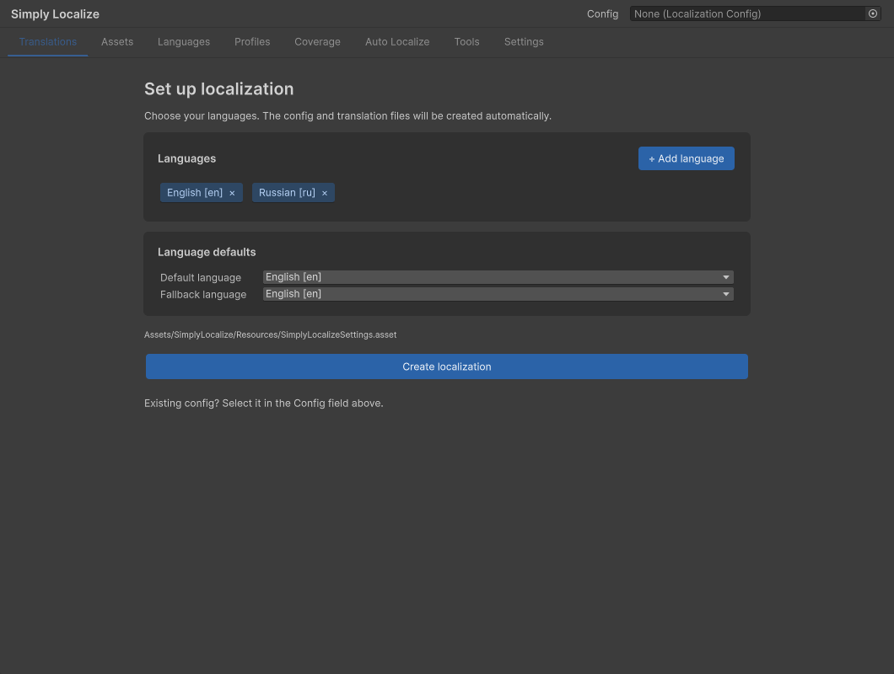
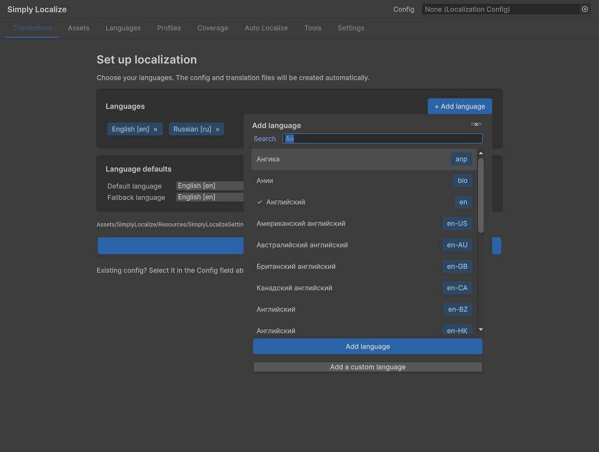
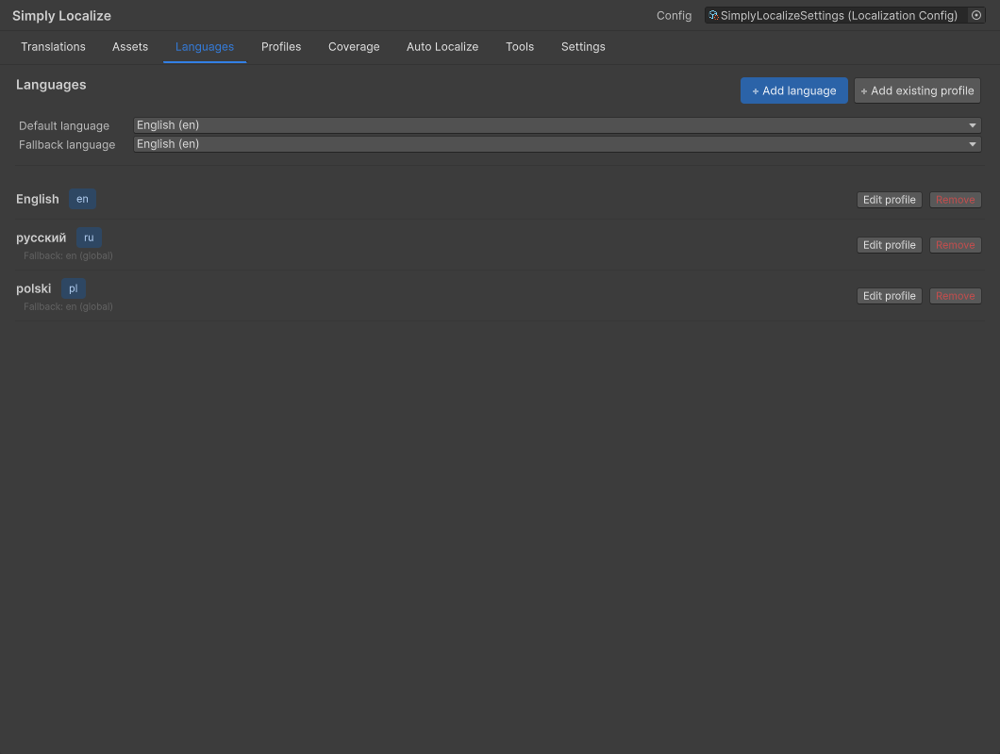
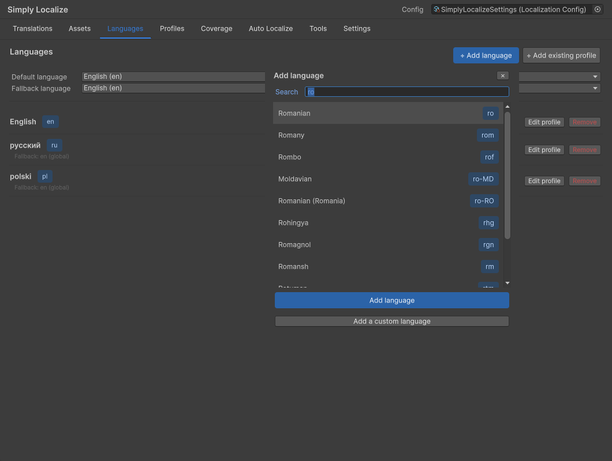
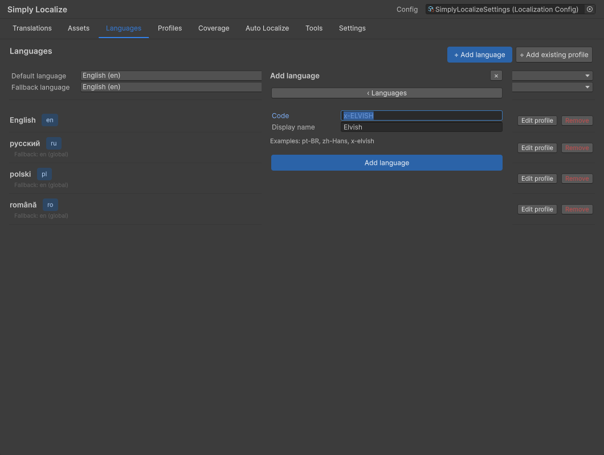
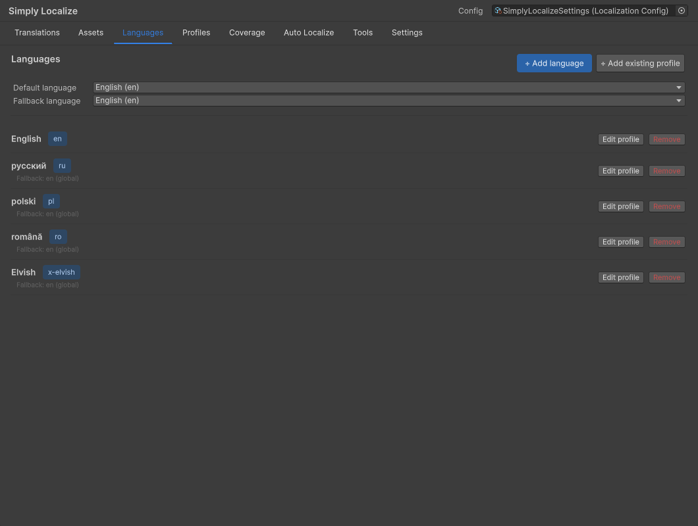

# Компактный выбор языков в Setup и Languages

2026-11-16. Unity 6000.0.62f1, dev/localization-stability.

## Что изменено

Постоянный список поиска перегружал стартовую форму. Теперь Setup показывает два отдельных блока: выбранные языки и default/fallback. Кнопка **+ Add language** открывает компактное всплывающее окно; после добавления оно остаётся открытым, чтобы можно было выбрать несколько языков подряд. Закрытие — крестиком, Escape или переходом в другое окно.

В **Languages** используется тот же компонент поиска с теми же названиями, проверкой кодов и ручным добавлением. Прежняя строка ввода кодов убрана. Новые профили получают отображаемое имя и SystemLanguage из справочника; default/fallback, существующие профили и JSON сохраняются. При недоступном для записи конфиге ошибка остаётся во всплывающем окне и действие можно повторить.

Результат поиска занимает одну строку: название и отдельная цветная метка кода. Поиск по кириллице показывает русское название; другие названия доступны в tooltip. Добавленные языки отмечены галочкой, повторное добавление через список недоступно. Справочник, правила поиска и нормализации из предыдущего шага сохранены.

Ручной режим называется **Add a custom language**. Он показывает только код, отображаемое имя, короткий пример и кнопку добавления. Возврат к списку — кнопкой Languages.

Главная форма ограничена по ширине, блоки разделены отступами, действия и коды отмечены цветом. Убраны постоянные информационные HelpBox, пустые No assets и подпись SystemLanguage возле каждого языка. SystemLanguage доступен в tooltip; профиль по-прежнему редактируется в Profiles. Путь создаваемого конфига остаётся виден. README обновлён.

## Проверки

- [WindowSetupTests](focused.json): 40 passed, 0 failed, 0 skipped.
- [Полный EditMode](editmode.json): 339 passed, 0 failed, 0 skipped.
- [PlayMode](playmode.json): 26 passed, 0 failed, 0 skipped.
- Три дополнительных регрессии: один и тот же popup в обеих точках входа; пользовательский язык без изменения default/fallback и JSON; read-only без частично созданного профиля с успешным повтором после снятия ограничения. Прежние проверки поиска и кодов теперь выполняются через popup.
- Первые прогоны выявили открытие popup до расчёта размеров UI и ошибку поиска отсутствующего элемента в тестовой оснастке. Добавлены резервные координаты открытия и корректный возврат отсутствующего элемента; финальные прогоны проходят без пропусков.
- Отдельный чистый проект: создание en/ru/pl через Setup, добавление ro и x-elvish через Languages, проверка пяти профилей и метаданных. [Результат](result.txt), [сценарий](CompactPickerShots.cs.txt).

Скриншоты сняты с реального Unity Editor через ReadScreenPixel. Проверена тёмная тема Unity 6000.0.62f1; другие версии редактора и сборки Player в этом шаге не проверялись. Сериализованные форматы, публичный API и следующие этапы плана не менялись. Все внутренние проверки и примеры находятся вне UPM-пакета.

## Скриншоты

