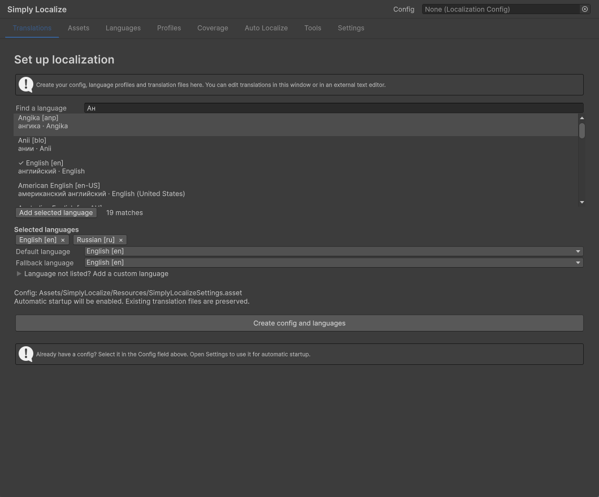
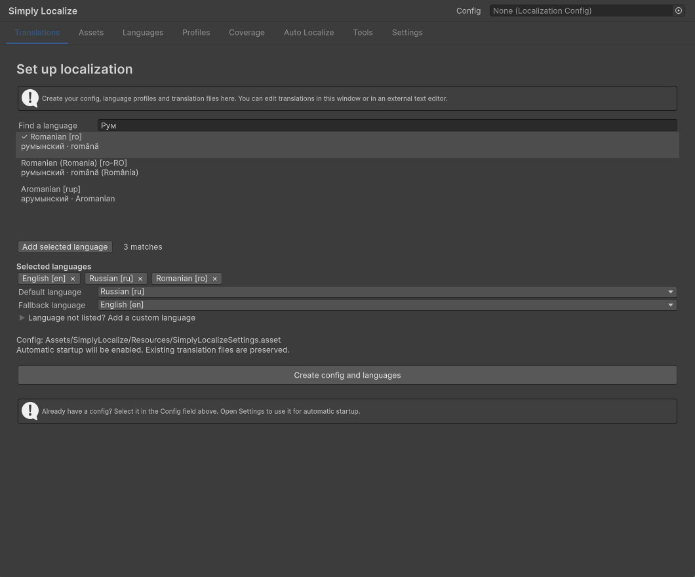
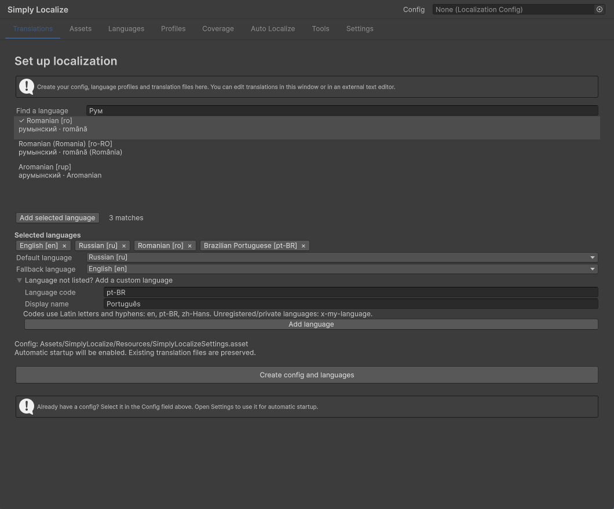
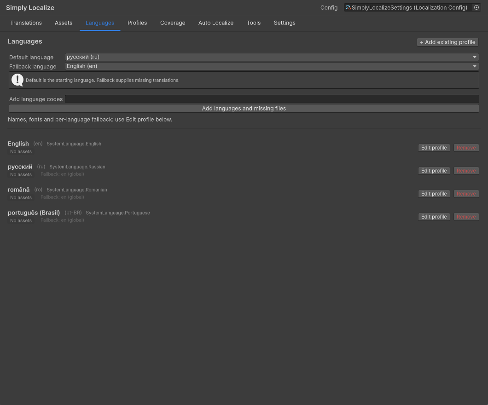

# Выбор языков в Setup Localization

2026-11-16. Unity 6000.0.62f1, ветка dev/localization-stability.

## Поведение

Вместо строки кодов начальная настройка предлагает поиск и список выбранных языков. Поиск понимает английское, русское и родное название, код и доступное ISO-сокращение. Например: `Ан` → английский среди первых результатов, `ru` → русский, `ro` → румынский, `francais` → французский. Короткие запросы ищут начало слова/кода; точное совпадение кода идёт первым. Результаты прокручиваются в виртуализированном ListView.

Выбранные языки видны отдельными кнопками с удалением. Default выбирается только из них, fallback — из них либо `(none)`. Удаление выбранного default назначает первый оставшийся язык; удаление выбранного fallback отключает его. Без языков создание недоступно. Повторное добавление не создаёт дубликат.

В разделе ручного добавления код приводится к нормальному регистру и разделителям: `PT_br` → `pt-BR`, `zh_hans` → `zh-Hans`, известный ISO-алиас `rus` → `ru`. Название языка, путь, кириллица в коде и неизвестные компоненты кода отклоняются до создания файлов. Для собственных незарегистрированных языков предусмотрены частные теги, например `x-elvish`, и пользовательское отображаемое имя. Для известного языка используется запись справочника, а не второе имя для того же кода.

Новые профили получают родное отображаемое имя и соответствующий Unity SystemLanguage, если такое соответствие известно. Существующие профили и переводы не перезаписываются. UI-выбор `(none)` действительно очищает глобальный fallback при повторной настройке. Публичный Configure и другие существующие Editor API сохранили прежний контракт; существующие коды и пути автоматически не нормализуются и не переименовываются.

## Справочники и границы

- Названия взяты из [Unicode CLDR 48.0.0](https://github.com/unicode-org/cldr-json/tree/48.0.0/cldr-json/cldr-localenames-full/main): английский и русский наборы. NativeName и дополнительные варианты дополняются через [CultureInfo.GetCultures](https://learn.microsoft.com/en-us/dotnet/api/system.globalization.cultureinfo.getcultures). В проверенном редакторе суммарно 870 записей; количество региональных вариантов может отличаться между средами .NET.
- Проверка компонентов использует снимок [реестра IANA](https://www.iana.org/assignments/language-subtag-registry/language-subtag-registry), File-Date 2026-09-17. Ручная форма рассчитана на обычные теги `language[-Script][-REGION][-variant]` и `x-...`. Это не полный парсер всех конструкций BCP 47: расширения, extlang, grandfathered-теги и проверка всех семантических сочетаний вариантов не добавлялись. Старые китайские обозначения zh-CHS/zh-CHT приводятся к zh-Hans/zh-Hant.
- Все справочники включены в Editor-код. Во время поиска интернет не используется, в Player справочник не попадает. Уведомление Unicode License V3 сохранено в файле данных. Новые зависимости пакета не добавлены.
- Изменён начальный Setup Localization. Последующая вкладка Languages сохраняет свой существующий способ добавления языков; runtime, провайдеры и следующие этапы плана не менялись.

## Проверки

- [EditMode](editmode.json): 336 passed, 0 failed, 0 skipped.
- [PlayMode](playmode.json): 26 passed, 0 failed, 0 skipped.
- WindowSetupTests: теперь 37 случаев, на 27 больше предыдущей версии. Покрыты поиск/приоритет, регистр/ISO-алиасы, региональные коды, пользовательские языки, некорректные компоненты, дубликаты, удаление default/fallback, пустой выбор, метаданные новых профилей, сохранность старых и очистка fallback.
- Сценарий в отдельном чистом проекте через реальные кнопки окна: поиск по русскому названию, добавление ro, выбор ru/en, нормализация PT_br и создание четырёх профилей с файлами. [Результат](result.txt), [сценарий съёмки](LanguagePickerShotSession.cs.txt).
- Первый просмотр изображения показал слишком много совпадений внутри слов для короткого запроса. Приоритет/фильтрация исправлены, добавлена регрессия, финальные тесты и скриншоты повторены.

Снимки сделаны с реального окна Unity через ReadScreenPixel. Другие версии Unity и сборки Player в этом шаге не проверялись. Тесты, примеры и этот отчёт находятся вне распространяемого UPM-пакета.

