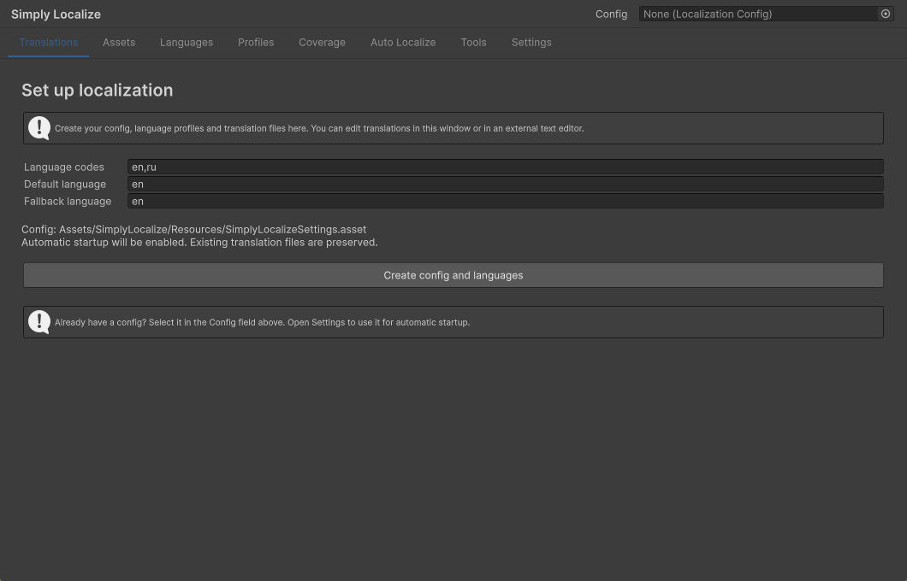
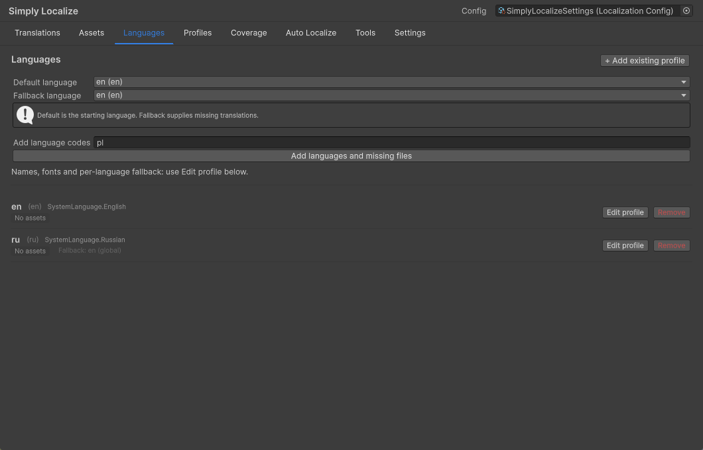
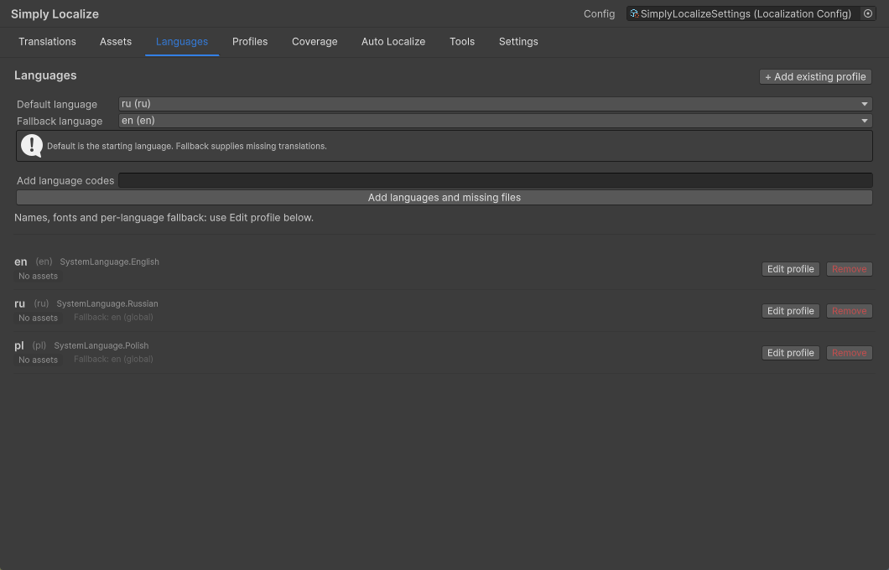
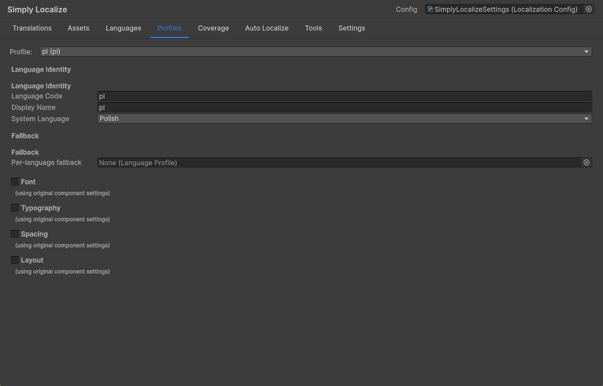
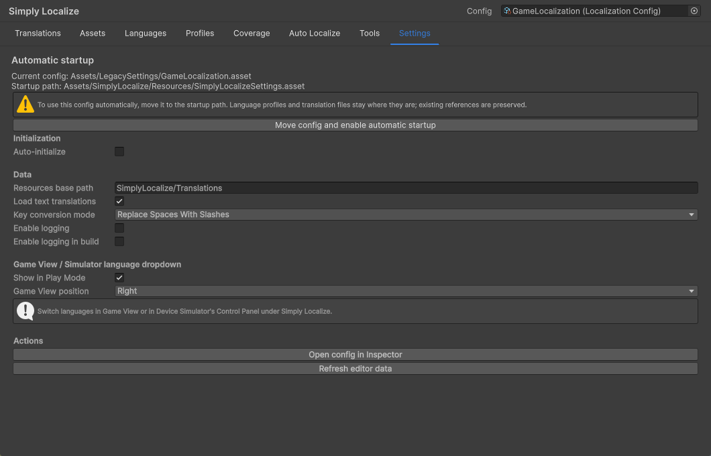
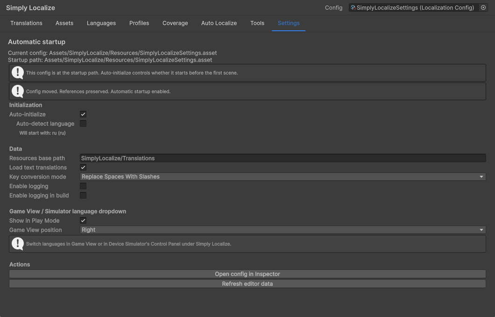

# Настройка через окно Simply Localize

Дата: 2026-11-16. Unity 6000.0.62f1. Ветка: dev/localization-stability.

## Что исправлено и зачем

Предыдущий шаг направлял пользователя из окна в Inspector для основной настройки. Это противоречило назначению окна и требованию автора. Теперь весь основной сценарий выполняется в Simply Localize:

1. Открыть Window → Simply Localize → Localization Editor. Без конфига появляется форма: коды языков, default и fallback. Кнопка Create config and languages создаёт конфиг, профили и недостающие JSON-файлы, включает автозапуск и открывает Languages.
2. В Languages добавлять языки по кодам, выбирать default/fallback из профилей. Повторное добавление не создаёт дубликатов и не перезаписывает переводы. Ошибки отображаются прямо в окне. Изменение default/fallback сохраняется; недоступный для записи конфиг оставляет прежнее значение.
3. Edit profile открывает выбранный язык во вкладке Profiles того же окна: имя, шрифты, типографика, направление текста и override-настройки. Возврат фокуса сохраняет введённые коды и выбранный профиль.
4. В Settings старый конфиг можно перенести кнопкой Move config and enable automatic startup, даже если autoInitialize был выключен. Показаны текущий и целевой пути; конфликт не перезаписывает другой конфиг. GUID, ссылки и несохранённые настройки сохраняются. Исправлено внутреннее имя объекта после переноса, поэтому Unity не предупреждает о несовпадении имени с файлом.

Inspector оставлен как дополнительный способ прямого редактирования. В нём есть кнопка открытия Simply Localize; обязательных действий в Inspector больше нет. При открытии окно предпочитает конфиг автозапуска, сохраняет назначенный конфиг и вкладку при перезагрузке скриптов. Устаревшие подсказки и README обновлены.

Фиксированный путь остаётся `Assets/SimplyLocalize/Resources/SimplyLocalizeSettings.asset`. Форматы переводов и сериализованные поля не менялись. Editor API настройки и запуск через командную строку сохранены. Старый публичный AddLanguagePopup также использует общий сервис добавления языков. Расширения окна через LocalizationEditorTabAttribute сохранены. Внутренние тесты находятся только в полигоне; этот отчёт и скриншоты находятся вне UPM-пакета.

## Проверки

- [EditMode](editmode.json): 309 passed, 0 failed, 0 skipped.
- [PlayMode](playmode.json): 26 passed, 0 failed, 0 skipped.
- 10 новых WindowSetupTests проверяют настоящие UI Toolkit-кнопки/поля: создание через окно, сохранность внешнего JSON и Selection, повторное добавление, default/fallback, неверные коды, read-only, выбор профиля, возврат фокуса, перенос и конфликт назначения, приоритет стартового конфига.
- ConfigDiscoveryTests дополнен проверкой имени объекта после переноса.
- В отдельном чистом проекте с локальным UPM-пакетом пройден сценарий кнопками окна: создать en/ru, добавить pl, выбрать ru основным, открыть профиль pl, перенести старый конфиг с сохранением GUID. [Результат](result.txt).
- Первый UI-прогон выявил ошибку очистки тестового окна, исправленную в тестовой оснастке. При съёмке выявлен сброс введённого кода после OnFocus; исправлен и добавлена регрессия. Приведённые выше результаты относятся к финальной версии.

Скриншоты сняты с настоящего окна Unity через ReadScreenPixel, без макетов и обработки изображения. [Сценарий съёмки](WindowShotSession.cs.txt) предназначен только для одноразового проекта `playgrounds/SimplyLocalize-Lab/TestResults/WindowSetup/WindowDemo`; перед повтором он удаляет только свои демонстрационные конфиги в этом проекте. Полигон и пользовательские настройки для примеров не переделывались. Сборки Player, другие версии Unity и публикация OpenUPM в этом исправлении не выполнялись.

## Примеры

Создание конфига и первых языков:

Добавление польского языка:

Три языка, основной русский и fallback английский:

Профиль польского языка внутри окна:

Старый конфиг перед переносом:

Результат переноса:

